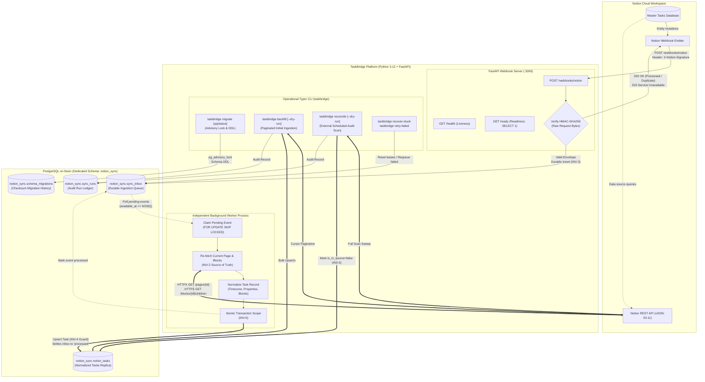
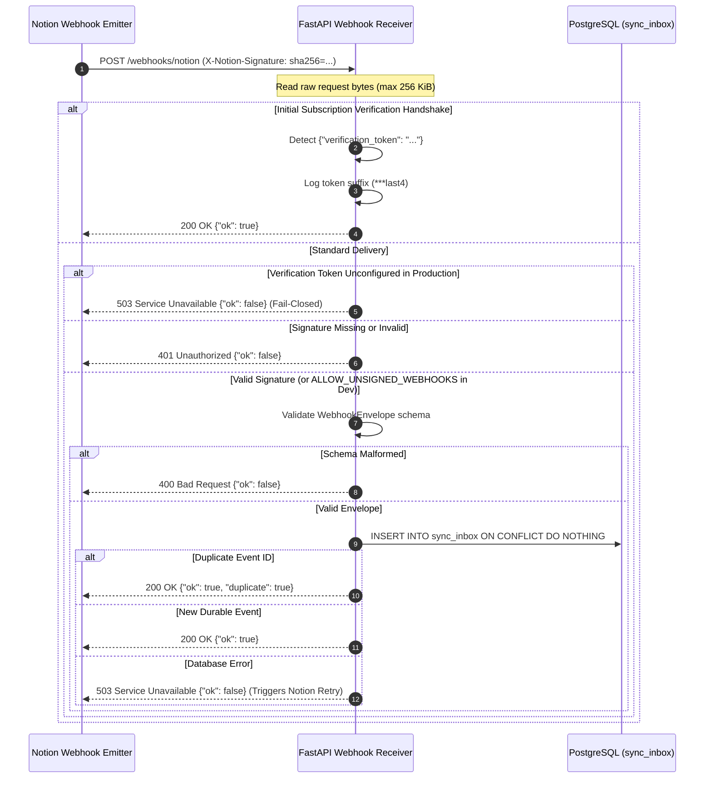
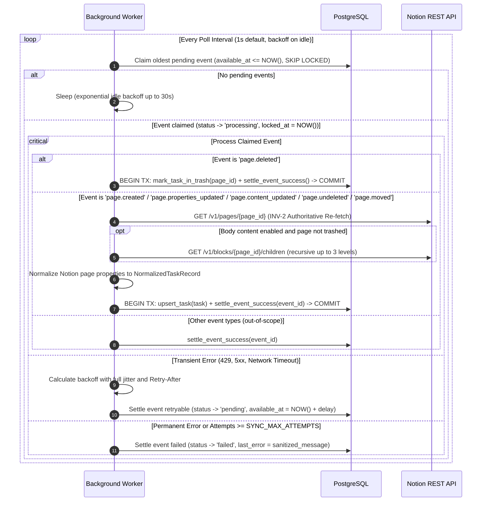
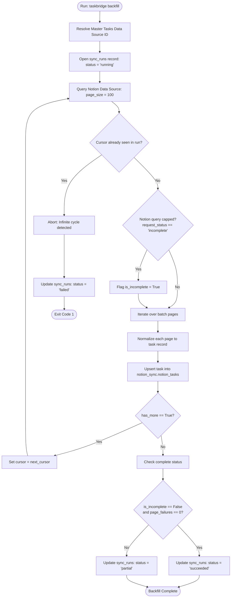
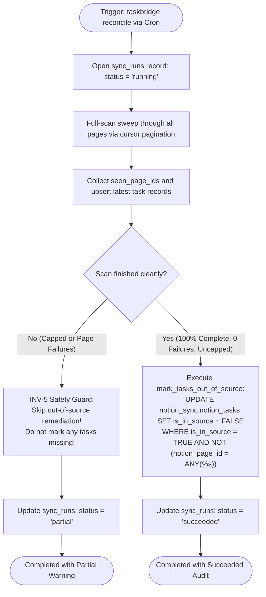

# TaskBridge

*Bridge your tasks. Synchronize with confidence.*

[](https://www.python.org/)
[](https://fastapi.tiangolo.com/)
[](https://www.uvicorn.org/)
[](https://www.postgresql.org/)
[](https://neon.tech/)
[](https://docs.pydantic.dev/)
[](https://www.psycopg.org/psycopg3/)
[](https://developers.notion.com/)
[](https://github.com/astral-sh/uv)
[](tests/)
[](https://github.com/astral-sh/ruff)
[](https://mypy-lang.org/)
[](Dockerfile)
[](.github/workflows/ci.yml)

**TaskBridge** is a Python-powered synchronization platform that replicates Notion tasks into PostgreSQL using FastAPI, durable webhook ingestion, and independent background processing.

| Metadata | Specification |
|---|---|
| **Application Name** | **TaskBridge** |
| **Tagline** | *Bridge your tasks. Synchronize with confidence.* |
| **Package Name** | `taskbridge` (v0.1.0) |
| **Project Purpose** | Replicate authoritative Notion task data into a query-efficient, normalized PostgreSQL replica |
| **Developer & Project Lead** | Dawood Rahman ([@mddawoodrahman](https://github.com/mddawoodrahman)) |
| **Repository** | [github.com/mddawoodrahman/notion](https://github.com/mddawoodrahman/notion) |
| **Python Version** | `>=3.12` (verified and tested on Python 3.12.15) |
| **Architecture** | Decoupled 3-process architecture: FastAPI Ingestion API + Independent Background Worker + Externally Scheduled CLI |
| **Automated Test Suite** | **145 passed** in 17 test files across 3 suites (95 unit, 41 real PostgreSQL integration, 9 e2e acceptance) |
| **License** | Proprietary — All rights reserved |

---

## Table of Contents

- [1. Project Overview & Philosophy](#1-project-overview--philosophy)
- [2. Key Features](#2-key-features)
- [3. Architecture and Design Principles](#3-architecture-and-design-principles)
- [4. The Seven Architectural Invariants](#4-the-seven-architectural-invariants)
- [5. Technology Stack](#5-technology-stack)
- [6. System Architecture Diagrams](#6-system-architecture-diagrams)
- [7. Webhook Ingestion Workflow](#7-webhook-ingestion-workflow)
- [8. Background Worker Workflow](#8-background-worker-workflow)
- [9. Backfill and Reconciliation Workflows](#9-backfill-and-reconciliation-workflows)
- [10. Project Directory Structure](#10-project-directory-structure)
- [11. Prerequisites](#11-prerequisites)
- [12. Installation and Local Setup](#12-installation-and-local-setup)
- [13. Environment Variables Reference](#13-environment-variables-reference)
- [14. Database Schema and Integrity](#14-database-schema-and-integrity)
- [15. HTTP API Documentation](#15-http-api-documentation)
- [16. Operational CLI Reference](#16-operational-cli-reference)
- [17. Testing and Quality Gates](#17-testing-and-quality-gates)
- [18. Docker and Docker Compose](#18-docker-and-docker-compose)
- [19. Production Deployment Architecture](#19-production-deployment-architecture)
- [20. Security and Integrity Guarantees](#20-security-and-integrity-guarantees)
- [21. Troubleshooting and Runbook](#21-troubleshooting-and-runbook)
- [22. Limitations and Roadmap](#22-limitations-and-roadmap)
- [23. Contributing, Maintenance, and License](#23-contributing-maintenance-and-license)

---

## 1. Project Overview & Philosophy

Notion is an exceptional workspace for personal task planning, organization, and daily prioritization. However, the Notion API has rate limits (3 requests per second per integration token), nested multi-level object schemas, and complex filtering rules that make it unsuitable as a backend for high-frequency queries, relational joins, multi-system automations, or downstream operational dashboards.

**TaskBridge** solves this problem by acting as an asynchronous, crash-resilient replication engine. Tasks managed in Notion are continuously mirrored into a dedicated schema (`notion_sync`) within PostgreSQL hosted on Neon.

### Core Tenets

1. **Notion is the Sole Source of Truth:** All user edits, task creations, status updates, categorizations, list assignments, and deletions originate exclusively in Notion. PostgreSQL is an authoritative, normalized, query-optimized read replica.
2. **Strict One-Way Synchronization:** Data flows only from Notion to PostgreSQL. Edits are never made directly in PostgreSQL and changes are never written back to Notion.
3. **Durable Ingestion First:** Inbound webhook notifications are validated, cryptographically verified, and committed to a durable PostgreSQL inbox (`sync_inbox`) before acknowledging delivery (`200 OK`) to Notion. If the database is unreachable, the API returns `503 Service Unavailable`, prompting Notion's built-in webhook retry mechanism.
4. **Authoritative Re-Fetch:** Webhook payloads serve solely as lightweight change signals. The background worker independently calls the Notion API to fetch the full, authoritative page state and nested block content before updating the PostgreSQL replica.
5. **No Destructive Physical Deletions:** Vanished or trashed tasks are never removed with SQL `DELETE`. Deletions are tracked via status flags (`notion_in_trash = true`, `is_in_source = false`), preserving referential integrity and auditability.
6. **Zero-Mock Database Testing:** Automated testing verifies SQL semantics, transactional rollbacks, advisory locks, and concurrency claims against real, isolated PostgreSQL clusters (verified on PostgreSQL 18 locally and containerized on PostgreSQL 17 in Docker Compose) rather than mocking the database driver.

---

## 2. Key Features

### Implemented V1 Features

- **FastAPI Webhook Receiver (`POST /webhooks/notion`):** Captures raw request bytes before JSON parsing to perform cryptographic HMAC-SHA256 signature verification (`X-Notion-Signature`). Enforces a strict 256 KiB payload ceiling.
- **Verification Handshake Protocol:** Automatically handles Notion's subscription verification handshake (`verification_token`), logs the token suffix (`***last4`) for operator convenience, and returns `200 {"ok": true}`.
- **Durable Webhook Queue (`notion_sync.sync_inbox`):** Stores event envelopes before HTTP acknowledgement. Uses `ON CONFLICT (event_id) DO NOTHING` for idempotent duplicate handling (`{"ok": true, "duplicate": true}`).
- **Concurrency-Safe Worker Process:** Polls pending inbox events using PostgreSQL's `FOR UPDATE SKIP LOCKED`, allowing multiple worker processes to run concurrently without duplicate claims or deadlocks.
- **Authoritative Notion State Re-Fetch (INV-2):** Discards sparse webhook property changes in favor of fetching the fresh, authoritative Notion page object and block hierarchy directly from `https://api.notion.com/v1`.
- **Atomic Transaction Commit (INV-6):** Executes task upsert (`notion_sync.notion_tasks`) and inbox status settlement (`processed`) within the exact same database transaction.
- **Stale Write Rejection (INV-4):** Employs an upsert guard checking `WHERE notion_tasks.notion_last_edited_time IS NULL OR EXCLUDED.notion_last_edited_time >= notion_tasks.notion_last_edited_time`. Prevents out-of-order webhook deliveries or null timestamps from overwriting newer task states.
- **Rich Task Normalization:** Maps Notion properties (Title, Status, List, Important, In My Day, Priority, Due Date/At, Reminder, custom user Archived checkbox) into native PostgreSQL datatypes (`TEXT`, `BOOLEAN`, `DATE`, `TIMESTAMPTZ`, `JSONB`).
- **IANA Timezone Awareness:** Uses `ZoneInfo(SYNC_TIMEZONE)` (default: `Asia/Kolkata`) to derive exact localized calendar due dates (`YYYY-MM-DD`) from timestamped Notion deadlines.
- **Recursive Body Content Serialization:** Traverses and nests up to 3 levels of Notion page body blocks, stored as structured JSONB (`page_content_json`). Callers that do not fetch blocks pass SQL `NULL` to preserve previously stored content via `COALESCE`.
- **Cursor-Paginated Initial Backfill:** CLI command (`uv run taskbridge backfill`) that paginates through the entire Notion Data Source, detects cursor cycles, logs audit metrics to `notion_sync.sync_runs`, and supports non-destructive preview mode (`--dry-run`).
- **Safe Reconciliation Engine (INV-5):** Full-scan CLI sweep (`uv run taskbridge reconcile`) designed for external schedulers (cron, systemd timer, Windows Task Scheduler). Flags vanished tasks as `is_in_source = false` **only if** the scan completes with 100% success, zero page errors, and uncapped Notion query results.
- **Self-Healing Operational Tooling:** Typer CLI commands to release expired worker leases (`uv run taskbridge recover-stuck`) and requeue permanently failed events back to pending (`uv run taskbridge retry-failed --limit 100`).
- **Transactional Schema Migration Runner:** Custom runner (`uv run taskbridge migrate`) utilizing session-level PostgreSQL advisory locks (`pg_advisory_lock`) and SHA-256 checksum-drift detection.
- **Liveness and Readiness Probes:** `GET /health` returns immediate HTTP 200 without dependencies; `GET /ready` validates active database pool connectivity with `SELECT 1`.
- **Structured JSON Logging & Secret Redaction:** Structured logs automatically redact API keys, database URLs, verification tokens, bearer headers, and signatures across dictionaries, strings, and exception chains.
- **Containerized Multi-Stage Builds:** Multi-stage `Dockerfile` running as unprivileged `appuser:appgroup` (UID 10001), orchestrated via `compose.yaml` with profiles for operational jobs and local development databases.

### Scope Guardrails (Explicit Non-Goals for V1)

- ❌ **No Two-Way Synchronization:** Changes in PostgreSQL are never pushed back to Notion.
- ❌ **No Productivity Dashboards / BI Views:** No built-in analytical charts, SQL reporting views, or productivity scorecards.
- ❌ **No Historical Event Sourcing:** No `task_events` or `daily_task_snapshots` audit tables.
- ❌ **No ML / AI Categorization:** No LLM summarization or automated task tagging.
- ❌ **No Binary Asset Storage:** No local caching or binary blob downloading of Notion file attachments.

---

## 3. Architecture and Design Principles

The service decouples webhook ingestion from processing, ensuring that network latency from Notion API calls or downstream processing delays never impacts webhook delivery acknowledgements.

```
┌────────────────────────────────────────────────────────────────────────┐
│                TaskBridge — Notion to PostgreSQL Sync Engine           │
├───────────────────────────────┬────────────────────────────────────────┤
│ 1. HTTP Ingestion Server      │ FastAPI + Uvicorn                      │
│    (Port 3000)                │ - Receives POST /webhooks/notion       │
│                               │ - Verifies HMAC-SHA256 signature       │
│                               │ - Durably writes to sync_inbox         │
│                               │ - Acknowledges 200 OK within 20ms      │
├───────────────────────────────┼────────────────────────────────────────┤
│ 2. Background Sync Worker     │ Independent Python Process             │
│    (Continuous Loop)          │ - Polls sync_inbox via SKIP LOCKED     │
│                               │ - Re-fetches fresh page & blocks       │
│                               │ - Normalizes rich Notion properties    │
│                               │ - Atomically upserts task & settles    │
├───────────────────────────────┼────────────────────────────────────────┤
│ 3. External Scheduled CLI     │ Typer CLI (Externally Scheduled)       │
│    (Cron / Task Scheduler)    │ - taskbridge reconcile (e.g. 30 min)   │
│                               │ - taskbridge backfill (one-shot)       │
│                               │ - taskbridge recover-stuck / retry     │
└───────────────────────────────┴────────────────────────────────────────┘
```

### Component Responsibilities

#### 1. FastAPI Application (`app/main.py`, `app/api/`)
Provides high-speed HTTP routes. It captures exact raw request bytes before JSON deserialization, validates the `X-Notion-Signature` header, validates the webhook envelope against `WebhookEnvelope`, and enqueues the event into `notion_sync.sync_inbox`. It intentionally **never** calls the Notion API or performs task normalization during the webhook request lifecycle.

> **Design Principle:** FastAPI's in-process `BackgroundTasks` is deliberately **not** used. In-process tasks are volatile; if the container restarts or crashes, uncompleted background tasks are lost. Storing events in PostgreSQL first guarantees durability (INV-3).

#### 2. Notion Client (`app/sync/notion_client.py`)
An asynchronous client wrapping `httpx.AsyncClient` targeting Notion API version `2026-03-11`. It resolves the master database data source ID, queries pages with cursor pagination, fetches page objects, and recursively fetches page block hierarchies. It automatically retries on transient network disconnects, HTTP timeouts, and HTTP 429/5xx responses using exponential backoff with full jitter and `Retry-After` header parsing (`app/sync/retry_policy.py`).

#### 3. PostgreSQL Data Layer (`app/db/`)
Built on Psycopg 3 (`psycopg[binary]`) and `psycopg_pool.AsyncConnectionPool`. Provides strict parameterized query execution (`%s`), async transaction blocks (`transaction_scope`, `with_transaction`), and dedicated repositories:
- `InboxRepository`: Enqueue, claim next pending with `FOR UPDATE SKIP LOCKED`, settle success/retryable/failed, recover expired leases, and retry failed events.
- `TasksRepository`: Idempotent upsert with INV-4 stale-write rejection, soft-deletion tombstones, and out-of-source scoping.
- `RunsRepository`: Audit ledger for tracking backfill and reconciliation runs.
- `migrate.py`: Transactional migration runner with advisory locking (`pg_advisory_lock(hashtext('notion_sync_migrations'))`) and SHA-256 integrity checksums.

#### 4. Background Worker (`app/sync/worker.py`, `app/cli/worker.py`)
A continuous, long-running loop that polls `sync_inbox` for pending events whose `available_at <= NOW()`. It claims an event by locking it and updating its status to `processing`. Depending on the event type (`page.created`, `page.properties_updated`, `page.content_updated`, `page.deleted`, `page.undeleted`, `page.moved`), it either executes an authoritative re-fetch or marks the task as trashed, then atomically updates the task and settles the inbox record.

#### 5. Operational CLI (`app/cli/main.py`)
A unified Typer CLI providing operational commands for the worker, initial backfill, scheduled reconciliation, lease recovery, event retries, and database migrations.

---

## 4. The Seven Architectural Invariants

Every modification to this codebase must preserve these 7 foundational invariants:

| Invariant | Principle | Enforcement Mechanism | Implementation Module | Regression Coverage |
|---|---|---|---|---|
| **INV-1** | **Stable Identity** | Exactly one row per Notion page UUID. No duplicate records across retries or backfills. No physical deletions (`DELETE FROM notion_tasks` is forbidden). | `PRIMARY KEY (notion_page_id)` in `notion_sync.notion_tasks` and `ON CONFLICT (notion_page_id) DO UPDATE`. | [`app/db/tasks_repo.py`](file:///d:/Notion/app/db/tasks_repo.py) | `tests/integration/test_repositories.py` |
| **INV-2** | **Authoritative State** | Webhooks are lightweight notifications, never the source of truth. The worker must re-fetch fresh page state from Notion before upserting. | `client.fetch_page(page_id)` executed prior to normalization in worker loop. | [`app/sync/worker.py`](file:///d:/Notion/app/sync/worker.py) | `tests/unit/test_worker.py` |
| **INV-3** | **Durable Webhook Ingestion** | A webhook is acknowledged (`200 OK`) only after being committed to `sync_inbox`. Database failures return `503 Service Unavailable`. Duplicates are acknowledged idempotently. | `InboxRepository.enqueue_event()` called before response; `ON CONFLICT (event_id) DO NOTHING`. | [`app/api/webhooks.py`](file:///d:/Notion/app/api/webhooks.py) | `tests/unit/test_webhooks.py`, `tests/e2e/test_acceptance.py` |
| **INV-4** | **Out-of-Order Protection** | Stale or out-of-order webhook deliveries must never overwrite newer task data. An incoming row with a null timestamp cannot overwrite a known timestamp. | SQL `WHERE notion_tasks.notion_last_edited_time IS NULL OR EXCLUDED.notion_last_edited_time >= notion_tasks.notion_last_edited_time`. | [`app/db/tasks_repo.py`](file:///d:/Notion/app/db/tasks_repo.py) | `tests/integration/test_repositories.py` |
| **INV-5** | **Safe Reconciliation** | Absence from a partial scan never implies deletion. Tasks are marked `is_in_source = false` only if the scan finished 100% cleanly with 0 errors and an uncapped result set. | `reconcile.py` verifies `scan_complete`, `not is_incomplete`, and `page_failures == 0` before updating out-of-source tasks. | [`app/sync/reconcile.py`](file:///d:/Notion/app/sync/reconcile.py) | `tests/unit/test_reconcile.py`, `tests/integration/test_repositories.py` |
| **INV-6** | **Transactional Integrity** | Task row upsert and inbox event settlement (`status = 'processed'`) must commit atomically within the same PostgreSQL transaction. | `with_transaction()` and `transaction_scope()` wrapping upsert and settlement in every worker branch. | [`app/sync/worker.py`](file:///d:/Notion/app/sync/worker.py), [`app/db/pool.py`](file:///d:/Notion/app/db/pool.py) | `tests/integration/test_repositories.py`, `tests/unit/test_worker.py` |
| **INV-7** | **Absolute Secret Redaction** | API tokens, DB connection passwords, webhook secrets, and signatures must never appear in logs, traces, or database error columns. | `RedactingJsonFormatter` in logging config and regex-based `sanitize_error_message()` in error taxonomy. | [`app/logging_config.py`](file:///d:/Notion/app/logging_config.py), [`app/errors.py`](file:///d:/Notion/app/errors.py) | `tests/unit/test_logging.py`, `tests/unit/test_config.py` |

---

## 5. Technology Stack

All dependencies are locked deterministically via `uv.lock`.

| Category | Technology | Verified Package Version | Role & Architectural Responsibility |
|---|---|---|---|
| **Language Runtime** | [Python](https://www.python.org/) | `3.12+` (tested on 3.12.15) | Modern Python runtime with strict type annotations and native `asyncio` |
| **Package Manager** | [uv](https://github.com/astral-sh/uv) | `>=0.5.0` (installed `0.13.0`) | Extremely fast, deterministic dependency resolution and virtualenv management |
| **Web Framework** | [FastAPI](https://fastapi.tiangolo.com/) | `>=0.115.0` (installed `0.162.0`) | High-performance ASGI framework handling webhook ingestion and health probes |
| **ASGI Web Server** | [Uvicorn](https://www.uvicorn.org/) | `>=0.32.0` (installed `0.54.0`) | Production ASGI server with standard HTTP/JSON extensions |
| **Database Server** | [PostgreSQL (Neon)](https://neon.tech/) | `PostgreSQL 17+` | Serverless PostgreSQL database hosting normalized tasks and durable inbox |
| **Database Driver** | [Psycopg 3](https://www.psycopg.org/psycopg3/) | `>=3.2.0` (installed `3.3.6`) | Native, type-safe PostgreSQL driver supporting parameterized queries |
| **Connection Pool** | [psycopg_pool](https://www.psycopg.org/psycopg3/docs/advanced/pool.html) | `>=3.2.0` (installed `3.3.3`) | Asynchronous connection pooling with automatic recovery and idle reaping |
| **HTTP Client** | [HTTPX](https://www.python-httpx.org/) | `>=0.27.0` (installed `0.28.1`) | Async HTTP client communicating with Notion REST API version `2026-03-11` |
| **Settings & Schemas** | [Pydantic v2](https://docs.pydantic.dev/) | `>=2.9.0` (installed `2.14.1`) | High-speed data parsing, environment validation, and envelope validation |
| **Config Loader** | [pydantic-settings](https://docs.pydantic.dev/latest/concepts/pydantic_settings/) | `>=2.6.0` (installed `2.16.1`) | Type-safe environment variable parsing with validation fail-fast rules |
| **Environment Loader** | [python-dotenv](https://github.com/theskumar/python-dotenv) | `>=1.0.0` (installed `1.2.4`) | Automatic `.env` loading outside test environments |
| **CLI Framework** | [Typer](https://typer.tiangolo.com/) | `>=0.12.0` (installed `0.27.3`) | Operational CLI commands (`worker`, `backfill`, `reconcile`, `migrate`, etc.) |
| **Code Formatter & Linter** | [Ruff](https://github.com/astral-sh/ruff) | `>=0.7.0` (installed `0.17.2`) | Fast Python linter and formatter enforcing modern idiomatic standards |
| **Type Checker** | [Mypy](https://mypy-lang.org/) | `>=1.12.0` (installed `2.4.0`) | Static type checking enforcing type safety and return-any warnings across app and tests |
| **Test Framework** | [pytest](https://pytest.org/) | `>=8.3.0` (installed `9.1.1`) | Test runner executing unit, integration, and e2e acceptance test suites |
| **Async Test Plugin** | [pytest-asyncio](https://github.com/pytest-dev/pytest-asyncio) | `>=0.24.0` | Asynchronous fixture and test execution support in pytest |
| **Container Engine** | [Docker](https://www.docker.com/) | Multi-stage build | Multi-stage reproducible container image (`python:3.12-slim-bookworm`) |
| **Container Orchestration** | [Docker Compose](https://docs.docker.com/compose/) | Compose v2 Spec (`compose.yaml`) | Multi-process service definitions (`api`, `worker`, `reconcile`, `postgres`) |
| **Continuous Integration** | [GitHub Actions](https://github.com/features/actions) | `ubuntu-latest` | Automated CI pipeline executing linting, formatting, type checking, pytest, and Docker builds |

---

## 6. System Architecture Diagrams

### Unified Architecture Flow



### Text Explanation of System Relationships

1. **Ingestion Layer:** Notion emits webhook events to `POST /webhooks/notion`. FastAPI captures the exact raw bytes, verifies the HMAC-SHA256 signature against `NOTION_WEBHOOK_VERIFICATION_TOKEN`, validates the envelope, and persists the payload into `notion_sync.sync_inbox`. The request is acknowledged immediately (`200 OK`), completely decoupled from downstream Notion API calls.
2. **Worker Layer:** The background worker runs in a separate process. It dequeues pending events using `FOR UPDATE SKIP LOCKED`. For active page events, it calls the Notion REST API to re-fetch the fresh page state and nested body blocks, normalizes the task, and opens an atomic PostgreSQL transaction that upserts `notion_sync.notion_tasks` and settles `notion_sync.sync_inbox`.
3. **Operational CLI:** Maintenance tasks (schema migrations, initial backfills, periodic reconciliations, stuck lease recovery, and retry requeuing) are executed via Typer CLI commands. Reconciliation runs externally on a configured cadence (e.g., cron or Windows Task Scheduler) to repair missed events and safely update out-of-source tasks.

---

## 7. Webhook Ingestion Workflow



### Webhook Ingestion Rules

- **Raw Request Body Verification:** The HMAC signature must be evaluated against the exact, unparsed request bytes. Parsing JSON first and re-serializing produces whitespace discrepancies that invalidate HMAC signatures.
- **Fail-Closed Security:** If `NOTION_WEBHOOK_VERIFICATION_TOKEN` is unset in production, the receiver fails closed, returning HTTP `503` without writing to the database. The `ALLOW_UNSIGNED_WEBHOOKS=true` setting is permitted only in `development` and is rejected at startup in `production`.
- **Durable Commitment:** A delivery is confirmed to Notion (`200 OK`) only after the insert into `sync_inbox` completes successfully.

---

## 8. Background Worker Workflow



### Worker Guarantees

- **No Stale Data Writes (INV-4):** The task upsert checks `notion_last_edited_time`. If an older event is processed after a newer one, PostgreSQL ignores the property updates and preserves the newer record.
- **Content Preservation (BUG-004):** When body blocks are not fetched or fail to fetch, `page_content_json` is passed as SQL `NULL`. The upsert uses `COALESCE(%(page_content_json)s::jsonb, notion_sync.notion_tasks.page_content_json)`, preserving previously stored blocks. When a page is genuinely empty, an empty array `[]` is passed and written.
- **Graceful Shutdown:** The worker listens for `SIGINT` and `SIGTERM`. It finishes processing any currently claimed event before stopping cleanly.

---

## 9. Backfill and Reconciliation Workflows

### 9.1 Initial Backfill Workflow (`taskbridge backfill`)



### 9.2 Scheduled Reconciliation Workflow (`taskbridge reconcile`)



> [!CRITICAL]
> **INV-5 Protection Against False Deletions:** If a network failure interrupts pagination, or if Notion caps query results at 10,000 items (`request_status.type == "incomplete"`), reconciliation **skips** out-of-source remediation entirely and marks the run as `partial`. Existing tasks in PostgreSQL are never marked missing due to incomplete API results.

---

## 10. Project Directory Structure

```text
D:/Notion/
├── pyproject.toml               # Project manifest, dependencies, entry points, tool configurations
├── uv.lock                      # Deterministic uv dependency lockfile
├── .python-version              # Pinned Python version (3.12)
├── .env.example                 # Sanitized environment configuration template
├── Dockerfile                   # Multi-stage production container build (Python 3.12-slim)
├── compose.yaml                 # Docker Compose multi-service topology (api, worker, reconcile, postgres)
├── .dockerignore                # Container build exclusions
├── .gitignore                   # Version control exclusions (.venv, .env, caches)
├── .github/                     # GitHub configuration
│   └── workflows/
│       └── ci.yml               # GitHub Actions CI pipeline (lint, format, typecheck, pytest, build)
├── AGENTS.md                    # Core architectural constraints and rules for agent tooling
├── README.md                    # Comprehensive repository documentation (this file)
│
├── app/                         # Primary Python Application Package
│   ├── __init__.py
│   ├── main.py                  # FastAPI application factory, routing, and Uvicorn entry point
│   ├── config.py                # Pydantic v2 Settings, environment parsing, and validation rules
│   ├── lifespan.py              # Application lifecycle context manager (connection pool lifecycle)
│   ├── logging_config.py        # Structured JSON logging with automatic secret redaction
│   ├── errors.py                # Error taxonomy, transient network detection, and secret scrubbing
│   │
│   ├── api/                     # HTTP API Route Handlers
│   │   ├── __init__.py
│   │   ├── health.py            # GET /health (liveness) and GET /ready (readiness with SELECT 1)
│   │   └── webhooks.py          # POST /webhooks/notion (raw bytes signature verification & inbox enqueue)
│   │
│   ├── db/                      # Database & Persistence Layer
│   │   ├── __init__.py
│   │   ├── pool.py              # Psycopg 3 connection pool, SSL configuration, and transaction context
│   │   ├── inbox_repo.py        # sync_inbox repository (enqueue, SKIP LOCKED claim, settlement, recovery)
│   │   ├── tasks_repo.py        # notion_tasks repository (INV-4 upsert, tombstones, out-of-source scoping)
│   │   ├── runs_repo.py         # sync_runs ledger (audit tracking for backfill and reconciliation)
│   │   └── migrate.py           # Database migration runner (advisory locking, SHA-256 checksums)
│   │
│   ├── sync/                    # Synchronization & Domain Logic
│   │   ├── __init__.py
│   │   ├── notion_client.py     # HTTPX Notion API client with rate-limiting, retries, and pagination
│   │   ├── normalize.py         # Pure transformation from Notion Page to NormalizedTaskRecord
│   │   ├── property_map.py      # Case-insensitive property resolution and candidate name mapping
│   │   ├── retry_policy.py      # Exponential backoff with full jitter and Retry-After header parsing
│   │   ├── worker.py            # Background worker execution loop and event dispatch matrix
│   │   ├── backfill.py          # Initial cursor-paginated data source backfill
│   │   └── reconcile.py         # Periodic full-scan reconciliation engine (INV-5 safe scans)
│   │
│   └── cli/                     # Typer Operational CLI Commands
│       ├── __init__.py
│       ├── main.py              # Root Typer CLI entry point (`taskbridge`) and `migrate` command
│       ├── worker.py            # `taskbridge worker` command
│       ├── backfill.py          # `taskbridge backfill` command
│       ├── reconcile.py         # `taskbridge reconcile` command
│       ├── recover_stuck.py     # `taskbridge recover-stuck` command
│       └── retry_failed.py      # `taskbridge retry-failed` command
│
├── migrations/                  # Schema Migration Definitions
│   └── 0001_init.sql            # Core DDL (notion_tasks, sync_inbox, sync_runs, indexes, constraints)
│
├── tests/                       # Automated Test Suites (145 passed across 17 files)
│   ├── __init__.py
│   ├── conftest.py              # Shared Pytest fixtures and environment configuration
│   ├── unit/                    # 13 Unit test files (95 tests: mocks, config, schemas, normalization)
│   │   ├── test_backfill.py
│   │   ├── test_config.py
│   │   ├── test_health.py
│   │   ├── test_logging.py
│   │   ├── test_migrate_cli.py
│   │   ├── test_migrations.py
│   │   ├── test_normalize.py
│   │   ├── test_notion_client.py
│   │   ├── test_pool.py
│   │   ├── test_reconcile.py
│   │   ├── test_repository.py
│   │   ├── test_webhooks.py
│   │   └── test_worker.py
│   ├── integration/             # 3 Integration test files (41 tests: real PostgreSQL instances)
│   │   ├── test_backfill.py
│   │   ├── test_migrations.py
│   │   ├── test_repositories.py
│   │   └── helpers/
│   │       └── test_database.py # Ephemeral PostgreSQL setup on random available ports
│   └── e2e/                     # 1 Acceptance test file (9 tests: full pipeline in-memory harness)
│       └── test_acceptance.py
│
├── docs/                        # Architectural Specifications & Operational Guides
│   ├── DEPLOYMENT_GUIDE.md      # Production runbook, least-privilege roles, and hosting topologies
│   ├── IMPLEMENTATION_STATUS.md # Phased implementation status and verified test evidence log
│   ├── Notion_to_PostgreSQL_Sync_SPEC.md # Full technical specification and engineering contracts
│   ├── PRD.md                   # Product requirements document and data dictionary
│   └── implementation-workflow.md # Phased protocol and quality acceptance gates
│
└── .agents/                     # Autonomous developer agent tooling and skill definitions (separate from runtime)
```

---

## 11. Prerequisites

Before installing and running the service, ensure the following are available:

1. **Python Runtime:** Version `3.12` or higher (verified on Python 3.12.15).
2. **uv Package Manager:** Astral's `uv` package manager (`pip install uv` or `curl -LsSf https://astral.sh/uv/install.sh`).
3. **PostgreSQL Database:**
   - A serverless [Neon PostgreSQL](https://neon.tech/) instance (recommended for production).
   - Alternatively, a standard local or containerized PostgreSQL instance (version 16, 17, or 18).
4. **Notion Internal Integration:**
   - Create an integration at [notion.so/my-integrations](https://www.notion.so/my-integrations).
   - Grant **Read content** permissions.
   - Share/connect the integration to your Notion Tasks Database (**Database settings → Connect to → Your Integration**).
5. **Notion Webhook Subscription:**
   - A configured webhook subscription pointing to your public HTTPS endpoint (`https://<your-domain>/webhooks/notion`).

---

## 12. Installation and Local Setup

Follow these copy-pasteable instructions for Windows PowerShell (or adapt for macOS/Linux shells):

### Step 1: Clone Repository and Navigate to Root

```powershell
git clone https://github.com/mddawoodrahman/notion.git
Set-Location D:\Notion
```

### Step 2: Synchronize Dependencies with uv

```powershell
# Installs all production dependencies, optional dev tools, and creates the virtualenv
uv sync --all-extras --dev
```

### Step 3: Configure Environment Variables

```powershell
# Copy the example environment template
if (-not (Test-Path .env)) {
    Copy-Item .env.example .env
}
```

Open `.env` in an editor and populate your credentials securely (see [Section 13](#13-environment-variables-reference)).

### Step 4: Run Quality Gates & Automated Tests

```powershell
# Run code linting, formatting checks, and static type checking
uv run ruff check app tests
uv run ruff format --check app tests
uv run mypy app tests

# Run the full automated test suite (145 tests across unit, integration, and e2e)
uv run pytest
```

### Step 5: Check and Apply Database Migrations

```powershell
# Check applied vs pending migrations
uv run taskbridge migrate status

# Apply pending schema migrations
uv run taskbridge migrate
```

### Step 6: Perform Initial Backfill (Dry Run First)

```powershell
# Preview data source resolution and task normalization without writing to the database
uv run taskbridge backfill --dry-run

# Run the live backfill to import all current Notion tasks into PostgreSQL
uv run taskbridge backfill
```

### Step 7: Launch API Server and Background Worker

The HTTP API server and the background sync worker run as **independent processes**. Open two separate terminals:

```powershell
# Terminal 1: Start FastAPI HTTP Webhook & Health API
uv run uvicorn app.main:app --host 0.0.0.0 --port 3000

# Terminal 2: Start Independent Background Sync Worker
uv run taskbridge worker
```

---

## 13. Environment Variables Reference

Configuration is managed via Pydantic Settings (`app/config.py`). Variable types, formats, and production constraints are strictly validated on startup.

| Variable | Type | Required? | Default | Purpose & Constraints |
|---|---|---|---|---|
| `APP_ENV` | `str` | Optional | `development` | Environment mode: `development`, `test`, or `production`. Alias: `NODE_ENV`. |
| `PORT` | `int` | Optional | `3000` | HTTP listening port (1 to 65535). |
| `NOTION_API_KEY` | `str` | **Required (Prod)** | None | Notion Internal Integration Token. Must start with `secret_` or `ntn_` in production. |
| `NOTION_DATABASE_ID` | `str` | **Required (Prod)** | None | 32-character hex UUID of the Notion Tasks Database. |
| `NOTION_DATA_SOURCE_ID` | `str` | Optional | None | Target Data Source UUID if the Notion Database contains multiple data sources. |
| `NOTION_VERSION` | `str` | Optional | `2026-03-11` | Pinned Notion API version. The application requires pinned version `2026-03-11`. |
| `NOTION_WEBHOOK_VERIFICATION_TOKEN` | `str` | **Required (Prod)** | None | Secret key used for HMAC-SHA256 signature verification. In production, missing this causes the webhook receiver to fail closed (`503`). |
| `ALLOW_UNSIGNED_WEBHOOKS` | `bool` | Optional | `false` | **Development-only escape hatch.** Bypasses webhook signature validation. **Forbidden in production** (startup raises `ConfigurationError`). |
| `DATABASE_URL` | `str` | **Required (Prod)** | None | Pooled PostgreSQL connection URL (e.g. Neon pooled endpoint `ep-...-pooler...`). Must start with `postgresql://` or `postgres://`. |
| `DIRECT_DATABASE_URL` | `str` | Optional | None | Direct PostgreSQL connection URL (e.g. Neon unpooled endpoint). Used by `taskbridge migrate` for session-level `pg_advisory_lock`. |
| `DB_SSL_INSECURE` | `bool` | Optional | `false` | **Development-only escape hatch.** Allows self-signed SSL certificates for local databases. Leave `false` for Neon and production. |
| `TEST_DATABASE_URL` | `str` | Optional | None | Optional custom PostgreSQL connection string for tests. If omitted, tests spin up ephemeral local instances. |
| `SYNC_TIMEZONE` | `str` | Optional | `Asia/Kolkata` | Valid IANA timezone name used to compute date-only deadlines (`due_date`) from timestamps. |
| `SYNC_RECONCILIATION_INTERVAL_MINUTES` | `int` | Optional | `30` | Recommended cadence for external reconciliation schedulers (1 to 1440). Informational; the service has no internal scheduler. |
| `SYNC_MAX_ATTEMPTS` | `int` | Optional | `8` | Maximum retry attempts for transient failures before marking an event as `failed` (1 to 20). |
| `SYNC_PAGE_SIZE` | `int` | Optional | `100` | Pagination page size for Notion queries (1 to 100). |
| `SYNC_SYNC_BODY_CONTENT` | `bool` | Optional | `true` | When true, fetches and serializes page body blocks into `page_content_json`. |
| `SYNC_LEASE_SECONDS` | `int` | Optional | `300` | Maximum lock lease duration for claimed inbox events before they are considered stuck (30 to 3600). |
| `LOG_LEVEL` | `str` | Optional | `info` | Logging verbosity: `trace`, `debug`, `info`, `warn`, `error`, `fatal`, `silent`. Automatically redacts secrets. |

### Connection URL Strategy: Pooled vs Direct

- **Application Runtime (`DATABASE_URL`):** Point to your **Neon Pooled endpoint** (`...-pooler.region.neon.tech`). Transaction poolers (PgBouncer) manage high concurrency and connection spikes efficiently.
- **Database Migrations (`DIRECT_DATABASE_URL`):** Point to your **Neon Direct endpoint** (`...region.neon.tech`). Session-level PostgreSQL advisory locks (`pg_advisory_lock`) are bound to the specific database session and are not supported across transaction poolers.

---

## 14. Database Schema and Integrity

All database tables reside inside a dedicated schema: `notion_sync`.

```
notion_sync
├── notion_tasks         # Current-state normalized tasks replica
├── sync_inbox           # Durable incoming webhook queue
├── sync_runs            # Audit ledger for backfill and reconciliation runs
└── schema_migrations    # Checksummed migration history ledger
```

### Table Definitions

#### 1. `notion_sync.notion_tasks`
Stores the normalized current state of each task page:

```sql
CREATE TABLE IF NOT EXISTS notion_sync.notion_tasks (
    notion_page_id          TEXT PRIMARY KEY,
    title                   TEXT        NOT NULL DEFAULT '',
    status                  TEXT,
    list_name               TEXT,
    important               BOOLEAN     NOT NULL DEFAULT FALSE,
    in_my_day               BOOLEAN     NOT NULL DEFAULT FALSE,
    priority                TEXT,
    due_date                DATE,
    due_at                  TIMESTAMPTZ,
    reminder_at             TIMESTAMPTZ,
    user_archived           BOOLEAN     NOT NULL DEFAULT FALSE,
    notion_is_archived      BOOLEAN     NOT NULL DEFAULT FALSE,
    notion_in_trash         BOOLEAN     NOT NULL DEFAULT FALSE,
    is_in_source            BOOLEAN     NOT NULL DEFAULT TRUE,
    page_url                TEXT,
    notion_created_time     TIMESTAMPTZ,
    notion_last_edited_time TIMESTAMPTZ,
    raw_properties          JSONB       NOT NULL DEFAULT '{}'::jsonb,
    page_content_json       JSONB       NOT NULL DEFAULT '[]'::jsonb,
    synced_at               TIMESTAMPTZ NOT NULL DEFAULT NOW(),
    CONSTRAINT notion_page_id_not_blank CHECK (length(notion_page_id) > 0)
);

CREATE INDEX IF NOT EXISTS notion_tasks_in_scope_idx ON notion_sync.notion_tasks (is_in_source, notion_in_trash);
CREATE INDEX IF NOT EXISTS notion_tasks_synced_at_idx ON notion_sync.notion_tasks (synced_at);
CREATE INDEX IF NOT EXISTS notion_tasks_due_date_idx ON notion_sync.notion_tasks (due_date) WHERE due_date IS NOT NULL;
```

#### 2. `notion_sync.sync_inbox`
Durable event queue for reliable webhook ingestion:

```sql
CREATE TABLE IF NOT EXISTS notion_sync.sync_inbox (
    event_id        TEXT PRIMARY KEY,
    event_type      TEXT        NOT NULL,
    entity_type     TEXT,
    entity_id       TEXT,
    event_timestamp TIMESTAMPTZ,
    payload         JSONB       NOT NULL,
    status          TEXT        NOT NULL DEFAULT 'pending'
                    CHECK (status IN ('pending','processing','processed','failed')),
    attempts        INTEGER     NOT NULL DEFAULT 0 CHECK (attempts >= 0),
    received_at     TIMESTAMPTZ NOT NULL DEFAULT NOW(),
    available_at    TIMESTAMPTZ NOT NULL DEFAULT NOW(),
    locked_at       TIMESTAMPTZ,
    processed_at    TIMESTAMPTZ,
    last_error      TEXT
);

CREATE INDEX IF NOT EXISTS sync_inbox_claim_idx ON notion_sync.sync_inbox (available_at, received_at) WHERE status = 'pending';
CREATE INDEX IF NOT EXISTS sync_inbox_lease_idx ON notion_sync.sync_inbox (locked_at) WHERE status = 'processing';
CREATE INDEX IF NOT EXISTS sync_inbox_failed_idx ON notion_sync.sync_inbox (received_at DESC) WHERE status = 'failed';
CREATE INDEX IF NOT EXISTS sync_inbox_entity_idx ON notion_sync.sync_inbox (entity_id) WHERE entity_id IS NOT NULL;
```

#### 3. `notion_sync.sync_runs`
Audit and operational ledger tracking batch operations:

```sql
CREATE TABLE IF NOT EXISTS notion_sync.sync_runs (
    run_id            BIGINT GENERATED ALWAYS AS IDENTITY PRIMARY KEY,
    run_type          TEXT        NOT NULL CHECK (run_type IN ('initial_backfill','reconciliation','manual_retry')),
    status            TEXT        NOT NULL CHECK (status IN ('running','succeeded','partial','failed')),
    started_at        TIMESTAMPTZ NOT NULL DEFAULT NOW(),
    finished_at       TIMESTAMPTZ,
    records_processed INTEGER     NOT NULL DEFAULT 0 CHECK (records_processed >= 0),
    error_message     TEXT,
    cursor_reached    TEXT,
    CONSTRAINT sync_runs_finished_after_start CHECK (finished_at IS NULL OR finished_at >= started_at)
);

CREATE INDEX IF NOT EXISTS sync_runs_type_started_idx ON notion_sync.sync_runs (run_type, started_at DESC);
```

#### 4. `notion_sync.schema_migrations`
Tracks applied migrations and their SHA-256 hashes to detect checksum drift:

```sql
CREATE TABLE IF NOT EXISTS notion_sync.schema_migrations (
    version     TEXT PRIMARY KEY,
    applied_at  TIMESTAMPTZ NOT NULL DEFAULT NOW(),
    checksum    TEXT NOT NULL
);
```

### Property Normalization Mapping

The normalization layer ([`app/sync/normalize.py`](file:///d:/Notion/app/sync/normalize.py)) maps Notion properties to PostgreSQL columns using preferred names with case-insensitive fallbacks:

| Target Column | Preferred Name | Alternative Candidate Names | PostgreSQL Type | Notes |
|---|---|---|---|---|
| `title` | `Task` | `Title`, `Name`, `Task Name` | `TEXT` | Plain text extracted from Notion rich text array |
| `status` | `Status` | `State` | `TEXT` | Extracted from Notion `status` or `select` property |
| `list_name` | `List` | `Category`, `Lists` | `TEXT` | Extracted from Notion `select` property |
| `important` | `Important` | `Star`, `Starred`, `Importance` | `BOOLEAN` | Extracted from Notion `checkbox` |
| `in_my_day` | `In My Day` | `My Day`, `MyDay` | `BOOLEAN` | Microsoft To Do–style daily focus checkbox |
| `priority` | `Priority` | `Urgency`, `Level` | `TEXT` | Extracted from `select` or `status` property |
| `due_date` | `Due Date` | `Due`, `Deadline`, `Date` | `DATE` | Calendar date (`YYYY-MM-DD`) in `SYNC_TIMEZONE` |
| `due_at` | `Due Date` | `Due`, `Deadline`, `Date` | `TIMESTAMPTZ` | Exact ISO timestamp if time was specified in Notion |
| `reminder_at` | `Reminder` | `Remind`, `Reminder Date` | `TIMESTAMPTZ` | Configured reminder timestamp |
| `user_archived` | `Archived` | `User Archived`, `Archived Task` | `BOOLEAN` | Custom checkbox property set by the user |
| `notion_is_archived`| (Page level) | N/A | `BOOLEAN` | Notion's native page-level archive state |
| `notion_in_trash` | (Page level) | N/A | `BOOLEAN` | Set true on `page.deleted` or Notion `in_trash = true` |
| `is_in_source` | (Parent level)| N/A | `BOOLEAN` | Set false if page is removed from target Data Source |

### Useful Read-Only SQL Queries

#### 1. Query All Active, In-Scope Tasks
```sql
SELECT notion_page_id, title, status, list_name, priority, due_date
FROM notion_sync.notion_tasks
WHERE is_in_source = TRUE
  AND notion_in_trash = FALSE
  AND user_archived = FALSE
ORDER BY due_date ASC NULLS LAST;
```

#### 2. Inspect Ingestion Inbox Status
```sql
SELECT status, COUNT(*) AS count
FROM notion_sync.sync_inbox
GROUP BY status;
```

#### 3. Inspect Failed Events with Sanitized Error Messages
```sql
SELECT event_id, event_type, entity_id, attempts, last_error, received_at
FROM notion_sync.sync_inbox
WHERE status = 'failed'
ORDER BY received_at DESC
LIMIT 10;
```

#### 4. Review Recent Reconciliation & Backfill Runs
```sql
SELECT run_id, run_type, status, records_processed, started_at, finished_at, error_message
FROM notion_sync.sync_runs
ORDER BY started_at DESC
LIMIT 5;
```

### Least-Privilege Database Role Setup

To secure production deployments, avoid connecting as the database superuser or database owner. Create a dedicated application role with limited permissions:

```sql
-- 1. Create dedicated application role
CREATE ROLE notion_sync_app WITH LOGIN PASSWORD 'replace_with_your_secure_password';

-- 2. Grant schema usage
GRANT USAGE ON SCHEMA notion_sync TO notion_sync_app;

-- 3. Grant table privileges (SELECT, INSERT, UPDATE only — NO DELETE)
GRANT SELECT, INSERT, UPDATE ON ALL TABLES IN SCHEMA notion_sync TO notion_sync_app;

-- 4. Grant sequence privileges (for sync_runs identity)
GRANT USAGE, SELECT ON ALL SEQUENCES IN SCHEMA notion_sync TO notion_sync_app;

-- 5. Set default privileges for future tables
ALTER DEFAULT PRIVILEGES IN SCHEMA notion_sync
  GRANT SELECT, INSERT, UPDATE ON TABLES TO notion_sync_app;
ALTER DEFAULT PRIVILEGES IN SCHEMA notion_sync
  GRANT USAGE, SELECT ON SEQUENCES TO notion_sync_app;
```

---

## 15. HTTP API Documentation

The FastAPI service exposes three HTTP endpoints:

### 1. `GET /health`
Liveness probe for container orchestrators and load balancers. Returns `200 OK` immediately without checking external dependencies.

- **Method:** `GET`
- **Path:** `/health`
- **Success Response (`200 OK`):**
  ```json
  {
    "status": "ok"
  }
  ```

### 2. `GET /ready`
Readiness probe verifying active database pool connectivity (`SELECT 1`).

- **Method:** `GET`
- **Path:** `/ready`
- **Success Response (`200 OK`):**
  ```json
  {
    "status": "ready",
    "timestamp": "2026-10-27T10:50:00.000000+00:00"
  }
  ```
- **Failure Responses (`503 Service Unavailable`):**
  When database connection pool is not initialized or unavailable:
  ```json
  {
    "status": "not_ready",
    "reason": "database_unavailable"
  }
  ```
  When the database probe query (`SELECT 1`) encounters an exception:
  ```json
  {
    "status": "not_ready",
    "reason": "database_check_failed"
  }
  ```

### 3. `POST /webhooks/notion`
Webhook ingestion endpoint receiving change notifications from Notion.

- **Method:** `POST`
- **Path:** `/webhooks/notion`
- **Headers:**
  - `Content-Type: application/json`
  - `X-Notion-Signature: sha256=<64-character-hex-digest>` (Required in production)
- **Size Limit:** Max 256 KiB (`MAX_WEBHOOK_BODY_BYTES`). Exceeding returns `413 Payload Too Large`.

#### Subscription Handshake Delivery
When setting up a webhook subscription in Notion, Notion delivers an initial handshake payload:
```json
{
  "verification_token": "secret_vft_sample_token_min_32_chars"
}
```
The server logs `Received Notion webhook verification token handshake` with token suffix `***last4` and responds:
```json
{
  "ok": true
}
```

#### Standard Event Delivery
Notion delivers task event envelopes:
```json
{
  "id": "evt_01JABC1234567890XYZ",
  "type": "page.properties_updated",
  "entity": {
    "type": "page",
    "id": "4009d0b1-0188-81b1-917b-e186d1d7ba8b"
  },
  "timestamp": "2026-10-27T10:50:00.000Z"
}
```

#### Response Codes

| Status Code | Response Body | Trigger Condition |
|---|---|---|
| `200 OK` | `{"ok": true}` | Handshake accepted OR event committed to `sync_inbox`. |
| `200 OK` | `{"ok": true, "duplicate": true}` | Duplicate delivery idempotently ignored (`ON CONFLICT DO NOTHING`). |
| `400 Bad Request` | `{"ok": false}` | Empty body, invalid JSON, or missing required envelope fields (`id`, `type`). |
| `401 Unauthorized` | `{"ok": false}` | Missing `X-Notion-Signature` header or HMAC-SHA256 signature mismatch. |
| `413 Payload Too Large`| `{"ok": false, "error": "payload_too_large"}` | Body exceeds 256 KiB limit. |
| `503 Service Unavailable`| `{"ok": false}` | `NOTION_WEBHOOK_VERIFICATION_TOKEN` not configured in production (fails closed), or database pool unavailable. |

---

## 16. Operational CLI Reference

All operational commands are packaged under the `taskbridge` Typer CLI:

```powershell
uv run taskbridge --help
```

### Available Commands

| Command | Syntax | Long-Running? | Modifies Database? | Purpose & Operational Usage |
|---|---|---|---|---|
| **Worker** | `uv run taskbridge worker` | **Yes** | Yes (`notion_tasks`, `sync_inbox`) | Starts the continuous background event processing loop. Polls `sync_inbox` via `SKIP LOCKED`, fetches Notion state, and updates tasks. |
| **Backfill** | `uv run taskbridge backfill` | No | Yes (`notion_tasks`, `sync_runs`) | Paginates through the entire Notion Tasks data source and imports all records into PostgreSQL. Logs metrics to `sync_runs`. |
| **Backfill Dry-Run**| `uv run taskbridge backfill --dry-run` | No | **No** | Executes the full backfill fetch and normalization pipeline without committing any task upserts to PostgreSQL. |
| **Reconcile** | `uv run taskbridge reconcile` | No | Yes (`notion_tasks`, `sync_runs`) | Runs a full audit sweep. Repairs missed property edits and safely marks vanished tasks as `is_in_source = false` (INV-5). |
| **Reconcile Dry-Run**| `uv run taskbridge reconcile --dry-run` | No | **No** | Runs full reconciliation scan without committing database modifications. |
| **Recover Stuck** | `uv run taskbridge recover-stuck` | No | Yes (`sync_inbox`) | Releases in-flight worker leases older than `SYNC_LEASE_SECONDS` (300s default), resetting events from `processing` to `pending`. |
| **Retry Failed** | `uv run taskbridge retry-failed --limit 100` | No | Yes (`sync_inbox`) | Resets permanently failed inbox events back to `pending` with `attempts = 0` for operator retry. Default limit: 100. |
| **Migrate Up** | `uv run taskbridge migrate` | No | Yes (`schema_migrations`, DDL) | Applies pending SQL migrations under a session-level advisory lock (`pg_advisory_lock`). |
| **Migrate Status** | `uv run taskbridge migrate status` | No | **No** | Inspects migration ledger and reports applied vs pending migration files and timestamps. |

> [!NOTE]
> `taskbridge reconcile` is a **one-shot CLI command**. The service contains **no in-process cron scheduler**. You must schedule this command using an external scheduler (cron, systemd timer, Windows Task Scheduler, or Kubernetes CronJob) at the cadence defined by `SYNC_RECONCILIATION_INTERVAL_MINUTES` (default: 30 minutes).

---

## 17. Testing and Quality Gates

The codebase enforces strict quality gates across linting, formatting, static type checking, and automated test execution.

### Verification Commands

```powershell
# 1. Fast code linting
uv run ruff check app tests

# 2. Formatting compliance verification
uv run ruff format --check app tests

# 3. Static type checking across all 53 source files
uv run mypy app tests

# 4. Full automated test suite (145 tests across 17 files)
uv run pytest

# 5. Run specific test tiers
uv run pytest tests/unit          # 95 fast unit tests
uv run pytest tests/integration   # 41 integration tests against real PostgreSQL
uv run pytest tests/e2e           # 9 full acceptance tests
```

### Verified Test Results

```text
============================= test session starts =============================
platform win32 -- Python 3.12.15, pytest-9.1.1, pluggy-1.7.0
rootdir: D:\Notion
configfile: pyproject.toml
testpaths: tests
plugins: anyio-4.15.1, asyncio-1.4.1
collected 145 items

tests\e2e\test_acceptance.py .........                                   [  6%]
tests\integration\test_backfill.py ......                                [ 10%]
tests\integration\test_migrations.py ..........                          [ 17%]
tests\integration\test_repositories.py .........................         [ 34%]
tests\unit\test_backfill.py ....                                         [ 37%]
tests\unit\test_config.py ...............                                [ 47%]
tests\unit\test_health.py ....                                           [ 50%]
tests\unit\test_logging.py ........                                      [ 55%]
tests\unit\test_migrate_cli.py .......                                   [ 60%]
tests\unit\test_migrations.py .......                                    [ 65%]
tests\unit\test_normalize.py ........                                    [ 71%]
tests\unit\test_notion_client.py ........                                [ 76%]
tests\unit\test_pool.py .......                                          [ 81%]
tests\unit\test_reconcile.py ...                                         [ 83%]
tests\unit\test_repository.py .....                                      [ 86%]
tests\unit\test_webhooks.py ..........                                   [ 93%]
tests\unit\test_worker.py .........                                      [100%]

============================ 145 passed in 17.94s =============================
```

### Regression Verification Coverage

- **BUG-001:** Target data source ID resolved once and cached during worker lifetime (`tests/unit/test_worker.py`).
- **BUG-002:** Notion 10,000-result query cap (`request_status = incomplete`) detected; reconciliation and backfill record `partial` and skip remediation (`tests/unit/test_notion_client.py`, `tests/unit/test_reconcile.py`, `tests/unit/test_backfill.py`).
- **BUG-003:** Status-less network timeouts, connection resets (`ECONNRESET`, `ETIMEDOUT`), and HTTPX exceptions classified as transient retryable errors (`tests/unit/test_notion_client.py`, `tests/unit/test_worker.py`).
- **BUG-004:** Content-preserving upsert semantics: SQL `NULL` preserves previously stored `page_content_json`, while an empty page (`[]`) overwrites it (`tests/unit/test_repository.py`, `tests/integration/test_repositories.py`).
- **BUG-005:** Migration CLI forwards operator arguments (`up`, `status`) cleanly via Typer (`tests/unit/test_migrate_cli.py`).
- **BUG-006:** Concurrency test asserts on the exact claimed set rather than positional row ordering (`tests/integration/test_repositories.py`).
- **BUG-007:** Atomic transaction rollback and connection release asserted on all worker error paths (`tests/unit/test_worker.py`, `tests/integration/test_repositories.py`).
- **BUG-008:** INV-4 guard strictly enforced: incoming null last-edited timestamps cannot bypass the guard (`tests/integration/test_repositories.py`).
- **SEC-001:** Missing webhook secret fails closed in production (`503`); `ALLOW_UNSIGNED_WEBHOOKS=true` rejected in production (`tests/unit/test_webhooks.py`, `tests/unit/test_config.py`).
- **SEC-002:** Verified TLS enforced for all non-local PostgreSQL connections (`tests/unit/test_pool.py`).
- **DOC-001:** Timezone-aware date calculations verified using `ZoneInfo` (`tests/unit/test_normalize.py`).

---

## 18. Docker and Docker Compose

### Production Multi-Stage Dockerfile

The `Dockerfile` uses a multi-stage architecture:
1. **Builder Stage:** Uses `python:3.12-slim-bookworm` with Astral's `uv` binary to install dependencies into a dedicated virtualenv with optimal layer caching.
2. **Runner Stage:** Copies the virtualenv and application source into a clean `python:3.12-slim-bookworm` image. Runs as unprivileged `appuser:appgroup` (UID/GID 10001).

```powershell
# Build production Docker image
docker build -t taskbridge:latest .
```

### Docker Compose Configuration (`compose.yaml`)

The `compose.yaml` file defines four services:
- `api`: FastAPI HTTP Webhook & Health API (port 3000, healthcheck on `/health`).
- `worker`: Asynchronous background sync worker.
- `reconcile`: One-shot reconciliation task (profile: `ops`).
- `postgres`: Optional local PostgreSQL 17 container for offline development and testing (profile: `local-db`).

```powershell
# Validate compose configuration
docker compose config

# Start API server and background worker
docker compose up -d api worker

# Inspect running container status
docker compose ps

# Follow container logs
docker compose logs -f api
docker compose logs -f worker

# Execute one-shot reconciliation run via Compose
docker compose run --rm reconcile

# Start optional local PostgreSQL container for testing
docker compose --profile local-db up -d postgres

# Stop all services
docker compose down
```

---

## 19. Production Deployment Architecture

Production hosting requires three distinct roles:

| Role | Process | Command | Scaling & Scheduling |
|---|---|---|---|
| **1. HTTP Webhook API** | FastAPI / Uvicorn | `uv run uvicorn app.main:app --host 0.0.0.0 --port 3000` | Scale horizontally behind HTTPS load balancer / reverse proxy. Configure `/health` for liveness and `/ready` for readiness. |
| **2. Background Worker** | Independent Worker | `uv run taskbridge worker` | Run as continuous background service (systemd, Kubernetes Deployment, or container worker). Uses `FOR UPDATE SKIP LOCKED` for concurrency safety. |
| **3. Reconciliation Job**| One-shot Typer CLI | `uv run taskbridge reconcile` | Trigger via **external scheduler** (cron, systemd timer, Windows Task Scheduler, Kubernetes CronJob) every 30 minutes. |

### External Scheduler Configuration

#### Linux Crontab (`crontab -e`)
```text
# Run reconciliation every 30 minutes
*/30 * * * * cd /opt/notion && /root/.cargo/bin/uv run taskbridge reconcile >> /var/log/notion-reconcile.log 2>&1
```

#### Systemd Timer (`/etc/systemd/system/notion-reconcile.timer`)
```ini
[Unit]
Description=Trigger Notion Tasks Reconciliation Every 30 Minutes

[Timer]
OnCalendar=*:0/30
Persistent=true

[Install]
WantedBy=timers.target
```

#### Windows Task Scheduler (PowerShell)
```powershell
$action = New-ScheduledTaskAction -Execute "uv" -Argument "run taskbridge reconcile" -WorkingDirectory "D:\Notion"
$trigger = New-ScheduledTaskTrigger -Once -At (Get-Date) -RepetitionInterval (New-TimeSpan -Minutes 30)
Register-ScheduledTask -Action $action -Trigger $trigger -TaskName "NotionTasksSyncReconcile" -Description "Periodic Notion Reconciliation"
```

### Pre-Deployment Verification Checklist

1. [ ] Target PostgreSQL schema created and migrations applied: `uv run taskbridge migrate status`.
2. [ ] Least-privilege database role configured (`notion_sync_app`).
3. [ ] `DATABASE_URL` uses Neon pooled endpoint with `sslmode=require`.
4. [ ] `DIRECT_DATABASE_URL` configured for migration operations.
5. [ ] Notion Internal Integration created and connected to Tasks database with Read permissions.
6. [ ] Public HTTPS endpoint configured and Notion webhook handshake completed.
7. [ ] `NOTION_WEBHOOK_VERIFICATION_TOKEN` retrieved and configured in host environment.
8. [ ] Initial backfill verified with `uv run taskbridge backfill --dry-run` then executed live.
9. [ ] External scheduler registered for `taskbridge reconcile`.
10. [ ] Health check probe configured on `GET /health` and readiness probe on `GET /ready`.

---

## 20. Security and Integrity Guarantees

- **Cryptographic Signature Verification:** Webhook deliveries are verified using HMAC-SHA256 constant-time comparison (`hmac.compare_digest`) over the exact raw request bytes.
- **Fail-Closed Policy (SEC-001):** If `NOTION_WEBHOOK_VERIFICATION_TOKEN` is unset in production, the API answers `503 Service Unavailable` and discards the delivery. `ALLOW_UNSIGNED_WEBHOOKS=true` is strictly rejected at boot in production.
- **Enforced TLS (SEC-002):** Database connections require verified TLS (`sslmode=require`) for all non-local hosts. Bypassing certificate checks via `DB_SSL_INSECURE=true` is forbidden outside development.
- **100% Parameterized SQL:** Queries use Psycopg 3 parameterized statements (`%s` or named parameters). Dynamic SQL string concatenation is strictly prohibited.
- **Automated Secret Redaction (INV-7):** Regex pattern scrubbers in `app/logging_config.py` and `app/errors.py` redact Notion tokens (`secret_...`, `ntn_...`), verification tokens (`vft_...`), database passwords, connection URLs, and authorization headers from logs, exceptions, and database columns.
- **Least Privilege Access:** The database schema is designed to operate without `SUPERUSER` or `DELETE` permissions (`SELECT`, `INSERT`, `UPDATE` only).
- **Zero Plaintext Secrets in Git:** `.env` is ignored by `.gitignore`. Real credentials belong only in environment variables or cloud secret managers.

---

## 21. Troubleshooting and Runbook

| Symptom | Likely Cause | Diagnostic Command | Remediation |
|---|---|---|---|
| **Webhook returns 401 Unauthorized** | Signature verification failed or `X-Notion-Signature` header missing. | Inspect log: `Rejected webhook delivery: signature verification failed`. | Verify `NOTION_WEBHOOK_VERIFICATION_TOKEN` matches the secret generated by Notion during subscription setup. Check reverse proxy does not mutate request bodies. |
| **Webhook returns 503 Service Unavailable** | Verification token missing in production, or database pool is disconnected. | Inspect log: `Rejecting webhook: NOTION_WEBHOOK_VERIFICATION_TOKEN is not configured`. | Set `NOTION_WEBHOOK_VERIFICATION_TOKEN` in `.env`. Ensure database is online and reachable from the container. |
| **Migration fails with advisory lock error** | Attempting to run migrations through a transaction pooler (PgBouncer). | Check if `DATABASE_URL` contains `-pooler`. | Set `DIRECT_DATABASE_URL` pointing to the direct unpooled Neon host and run `uv run taskbridge migrate`. |
| **Events stuck in `processing` status** | Worker process crashed while processing an inbox event lease. | Check `sync_inbox` for rows where `status = 'processing'` and `locked_at < NOW() - 5 min`. | Run `uv run taskbridge recover-stuck` to reset expired leases back to `pending`. (Worker also recovers leases every 60s automatically). |
| **Events in `failed` status** | Event reached maximum retries (`attempts >= SYNC_MAX_ATTEMPTS`) or hit a permanent error. | Run query: `SELECT event_id, last_error FROM notion_sync.sync_inbox WHERE status = 'failed';` | Resolve underlying issue (e.g. invalid Notion permissions) and requeue with `uv run taskbridge retry-failed --limit 100`. |
| **Notion API returns 429 Too Many Requests** | Rate limit exceeded (3 requests/sec limit per token). | Inspect logs for `Retrying Notion API call after transient failure`. | The client automatically backs off using jittered exponential backoff and `Retry-After`. If persistent, reduce `SYNC_PAGE_SIZE`. |
| **Reconciliation completes with `partial` status** | Notion query capped at 10,000 items (`request_status = incomplete`) or a page failed to fetch. | Inspect `sync_runs.error_message` or run `uv run taskbridge reconcile`. | INV-5 safely prevented false out-of-source deletions. Check Notion database size. If >10k items, narrow the data source filter in Notion. |
| **FastAPI fails startup with `ConfigurationError`** | Required environment variables missing or invalid (e.g. invalid timezone, wrong token format). | Check startup stderr output. | Review error message. Ensure `NOTION_API_KEY`, `NOTION_DATABASE_ID`, and `DATABASE_URL` are provided in valid formats. |
| **Port 3000 already in use** | Another service or previous container instance is bound to port 3000. | Windows: `netstat -ano \| findstr :3000` | Terminate conflicting process or set `PORT=3001` in `.env`. |

---

## 22. Limitations and Roadmap

### Current Limitations

- **One-Way Synchronization:** The service is strictly a one-way mirror from Notion to PostgreSQL. Edits made in PostgreSQL do not replicate back to Notion.
- **External Scheduler Requirement:** The platform has no in-process cron daemon. Periodic reconciliation requires an external trigger (cron, systemd timer, Task Scheduler, or Kubernetes CronJob).
- **Block Content Depth:** Nested block hierarchy serialization is capped at 3 levels deep to prevent unbound recursion and latency on deeply nested Notion page trees.
- **Single Master Data Source:** If a Notion Database contains multiple data sources, `NOTION_DATA_SOURCE_ID` must be explicitly configured in `.env`.
- **Live Notion/Neon Credentials:** Local automated verification is 100% green across all 145 unit, integration, and e2e tests. Live end-to-end webhook delivery against production Notion and Neon remains dependent on deploying with live user credentials.

### Future Roadmap

- [ ] OpenTelemetry and Prometheus metrics exporter for queue lag, lease duration, and sync run times.
- [ ] User-configurable custom property mappings via external YAML/JSON configuration.
- [ ] Outbound event notifications (e.g., webhook emitter or message queue publisher when tasks change).

---

## 23. Contributing, Maintenance, and License

### Development Workflow

1. Fork or branch from `main`.
2. Ensure Python `>=3.12` and `uv` are installed.
3. Install dependencies: `uv sync --all-extras --dev`.
4. Run all quality gates before committing:
   ```powershell
   uv run ruff check app tests
   uv run ruff format --check app tests
   uv run mypy app tests
   uv run pytest
   ```
5. Ensure any schema modifications include a corresponding migration file in `migrations/` and preserve the 7 architectural invariants.
6. Keep `pyproject.toml` and `uv.lock` synchronized. Never commit `.env` or live credentials.

### Maintainer Information

- **Developer & Project Lead:** Dawood Rahman ([@mddawoodrahman](https://github.com/mddawoodrahman))
- **Repository:** [github.com/mddawoodrahman/notion](https://github.com/mddawoodrahman/notion)

### License

Proprietary — Developed by Dawood Rahman. All rights reserved.
