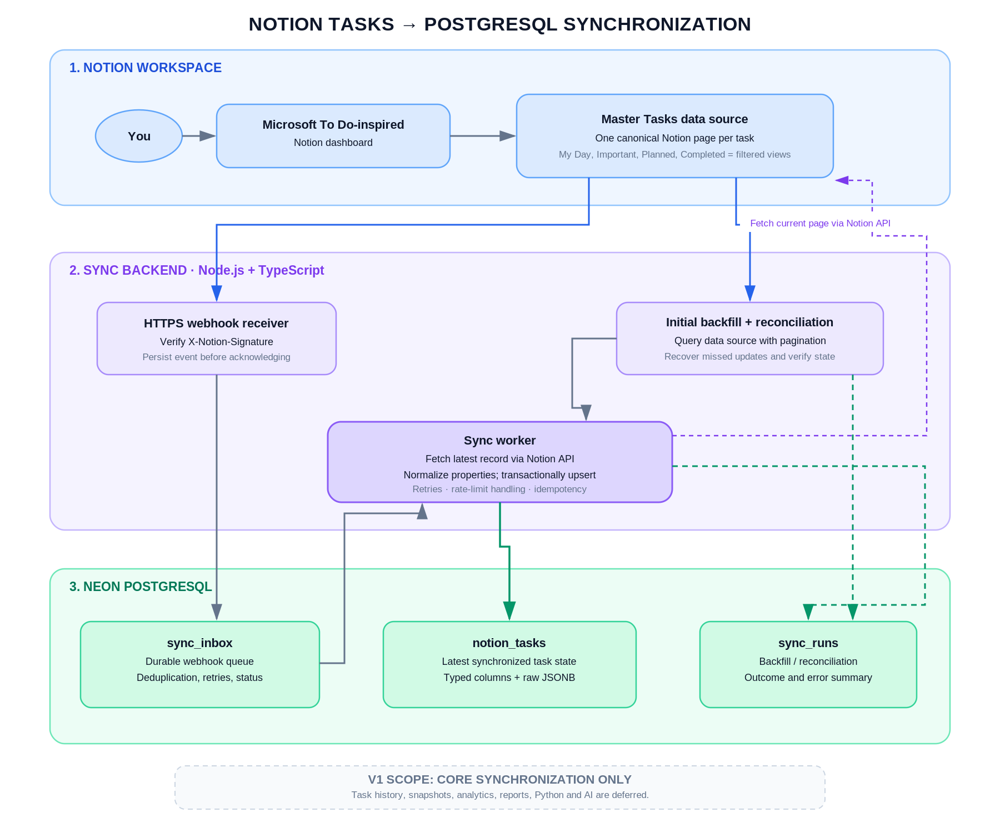

# Product Requirements Document (PRD)

## Notion To Do → PostgreSQL Synchronization Service

**Document status:** Ready for implementation planning  
**Version:** 1.0  
**Prepared:** 21 October 2026  
**Product owner:** Project owner / workspace administrator  
**Scope:** One-way synchronization of a Notion task database into PostgreSQL  
**Primary stack:** Notion API, Node.js, TypeScript, PostgreSQL on Neon  

---

## Document control

| Field | Detail |
|---|---|
| Product | Notion Tasks PostgreSQL Sync |
| Release target | V1 — core data synchronization |
| Source of truth | Notion master Tasks database |
| Destination | Dedicated PostgreSQL database |
| Data direction | Notion → PostgreSQL only |
| API version | `2026-03-11` (pin and verify against the official Notion API docs before deployment) |
| Analytics / reporting | Explicitly deferred; not part of V1 |
| Status | Specification; credentials, workspace IDs, and hosting still need to be supplied by the owner |

## 1. Executive summary

This project connects the existing Microsoft To Do–inspired Notion task manager to a dedicated PostgreSQL database. The existing Notion workspace remains the place where the user creates, edits, completes, reopens, archives, and deletes tasks. A small backend service imports current tasks and keeps their latest synchronized state in PostgreSQL.

The integration consists of four main capabilities:

1. **Initial backfill:** import existing task pages through the Notion API using pagination.
2. **Incremental synchronization:** receive Notion webhook events, verify their authenticity, retrieve the current page from Notion, normalize it, and upsert it into PostgreSQL.
3. **Operational resilience:** store webhook events durably before acknowledging them, retry failed work, and periodically reconcile the local copy against Notion.
4. **Operational visibility:** record sync runs, processing status, and actionable errors without exposing credentials or unnecessary task content in logs.

PostgreSQL V1 stores the latest task state and raw Notion property/body representations needed to avoid discarding fields. It does **not** add business analytics, task history, daily snapshots, productivity reports, AI insights, or a new task UI. Those are future phases and must not delay the core synchronization release.

## 2. Problem statement

The task manager already exists in Notion. The owner wants a durable PostgreSQL copy so that task information is not limited to the Notion interface and can support future use cases. Before any analysis is added, the integration must reliably transfer existing tasks and keep the PostgreSQL copy aligned with changes made in Notion.

A naive implementation that simply inserts webhook payloads is insufficient: webhook events do not represent the full latest task record, can be aggregated or reordered, and can be retried. Similarly, an initial query that only reads its first response would silently omit tasks. The system therefore needs stable task identity, pagination, idempotent upserts, event deduplication, retries, signature verification, and periodic reconciliation.

## 3. Product goals and success criteria

### 3.1 Goals

- Keep Notion as the only task-editing interface and system of record.
- Import all accessible task records from the authorized master Tasks data source.
- Maintain one PostgreSQL row per Notion page ID, regardless of how many linked views show the task.
- Synchronize property edits, task creation, task completion/reopening, archive changes, page movement, and deletion/restoration state when the Notion API exposes the change.
- Preserve source property data in JSONB so fields not yet mapped to typed columns are not silently discarded.
- Store task page body blocks for notes/checklists where the integration has permission and can retrieve them through the API.
- Recover from missed notifications or temporary backend/API outages through retries and reconciliation.
- Make operational failures visible and debuggable.

### 3.2 V1 success criteria

The release is considered successful when all of the following are true:

1. An initial backfill finishes successfully and imports every accessible task page within the configured source data set.
2. Re-running the backfill does not create duplicate task rows.
3. Creating or changing a task in Notion results in the matching PostgreSQL row being inserted or updated, normally within five minutes of the event reaching Notion's webhook delivery window; this is a target, not a hard guarantee during third-party outages.
4. Duplicate webhook deliveries do not create duplicate inbox events or duplicate task rows.
5. If PostgreSQL is temporarily unavailable, the webhook endpoint does not falsely acknowledge an event that was not durably stored.
6. The worker can resume pending events after a restart.
7. A scheduled reconciliation repairs missed/failed current-state updates without deleting records based solely on an incomplete scan.
8. No API token, webhook verification token, database password, or full secret-bearing connection string appears in source control or logs.
9. Acceptance tests cover create, update, completion, reopen, archive, move/delete/restore handling, retry, and reconciliation.

## 4. Non-goals and deferred scope

The following are **out of scope for V1**:

- Productivity analysis, SQL reporting views, charts, KPIs, and dashboards.
- Python, Pandas, BI, AI or machine-learning insights.
- `task_events` for permanent business history, and `daily_task_snapshots` for analytics.
- Bidirectional synchronization or editing tasks directly in PostgreSQL.
- Rebuilding the Notion dashboard or maintaining a separate custom task UI.
- Synchronizing Notion users/comments/discussions unless later added as an explicit requirement.
- Downloading and permanently storing binaries for Notion-hosted attachments. V1 may preserve block/file metadata and link references; temporary file URLs must not be treated as permanent object storage.
- General-purpose workspace replication. Access is limited to the authorized master Tasks data source and related task-page content.
- Automatically changing Notion task properties from PostgreSQL.

This exclusion matters: V1 is a synchronization layer, not a replacement for Notion and not an analytics product.

## 5. Users and system actors

| Actor | Need / responsibility |
|---|---|
| Task owner | Continues to manage tasks from the Notion dashboard. |
| Workspace administrator | Creates/authorizes the Notion integration and grants access to the correct task database. |
| Sync service | Reads the task data source and page content, normalizes records, and writes PostgreSQL. |
| Webhook receiver | Verifies event signatures and durably records event notifications. |
| Background worker | Claims pending events, fetches current records, and performs idempotent upserts. |
| Scheduler | Starts backfill/reconciliation jobs and records job results. |
| Database operator | Manages database credentials, backups, migrations, access roles, and operational recovery. |

## 6. Architecture overview



### 6.1 Architecture principles

- **Notion is the source of truth.** No PostgreSQL mutation should write back to Notion in V1.
- **The Notion page ID is the stable external key.** Titles are not unique and may change.
- **Webhooks are change signals, not complete records.** The worker fetches the latest page after receiving an event.
- **Event receipt is durable.** Acknowledge a webhook only after the event has been committed to `sync_inbox`.
- **Idempotency is required.** Backfill, reconciliation, and webhook retry must safely process the same task multiple times.
- **Reconciliation closes delivery gaps.** Webhooks improve freshness; a full or safely scoped paginated scan repairs missed events.
- **Raw source data is retained.** Known task fields get typed columns; original properties and body blocks also remain in JSONB.
- **Least privilege.** Read Notion content only; grant the database role only the permissions required by the application.

### 6.2 Main components

| Component | Responsibility | V1 implementation |
|---|---|---|
| Notion Tasks data source | Operational task records and Notion task pages | Existing Notion database; not recreated |
| Notion API client | Read data source metadata, query task pages, retrieve pages and blocks | Official `@notionhq/client` SDK, pinned to a compatible version |
| Initial backfill runner | Import existing tasks in cursor-paginated batches | CLI/script using shared normalization and repository code |
| HTTPS webhook endpoint | Receive, verify, validate and persist events | Node.js + TypeScript HTTP service |
| `sync_inbox` | Durable event inbox with deduplication and retries | PostgreSQL table; worker claims pending rows safely |
| Sync worker | Fetch latest Notion record and upsert its state | Worker process or reliable worker loop |
| PostgreSQL repository | Parameterized queries and transactional writes | `pg` package or equivalent supported Postgres client |
| Reconciliation job | Re-scan authorized source and repair current state | Scheduled command/job |
| `sync_runs` | Track backfill/reconciliation execution status | PostgreSQL operational table |
| Health/readiness endpoints | Expose service and database status | Minimal protected operational endpoints as appropriate |

## 7. Primary application flow

### 7.1 Initial backfill flow

1. Validate required environment variables and connectivity.
2. Retrieve the Notion database metadata and resolve the intended `data_source_id`.
3. Confirm the integration has access to the data source.
4. Start a `sync_runs` row with type `initial_backfill` and status `running`.
5. Query the data source using the current endpoint, `POST /v1/data_sources/{data_source_id}/query`.
6. Follow `has_more` and `next_cursor` until pagination is complete.
7. Normalize each page into typed columns plus `raw_properties` JSONB.
8. Retrieve and serialize task page body blocks if body-content sync is enabled and permitted. Recursively paginate block children as required; do not assume one response contains every block.
9. Upsert tasks using `notion_page_id` as the primary key, replacing the PostgreSQL current-state representation with the latest source representation.
10. Record the final record count, finish time, and result in `sync_runs`.
11. Mark the run successful only after all required pages are processed; if a page fails permanently, report the partial failure rather than silently claiming a complete import.

### 7.2 Incremental update flow

1. Notion sends a webhook to the public HTTPS endpoint.
2. The endpoint captures the raw request body and verifies `X-Notion-Signature` using the Notion webhook verification token.
3. Validate the event schema and required identifiers.
4. Insert the event into `sync_inbox` using the Notion event ID as a unique key.
5. Commit the insert, then return a success response. If durable storage fails, return a retryable server error instead of acknowledging the event.
6. The worker claims a pending event using a concurrency-safe operation (for example, transactionally with `FOR UPDATE SKIP LOCKED`).
7. For a page event, fetch the latest page from Notion and, where needed, fetch latest block children.
8. Normalize and upsert inside a PostgreSQL transaction.
9. Mark the inbox row as `processed`. On transient failure, increase attempts and set a retry time; on exhausted retries, leave a visible `failed` state and alert/log it.
10. Reconciliation later compares the authorized source against PostgreSQL and repairs missed current-state changes.

### 7.3 Event handling and state semantics

| Notion signal | Required behavior |
|---|---|
| Page created | Fetch page; if it belongs to the configured Tasks data source, upsert it. |
| Page properties updated | Fetch the current page; replace the normalized property state. |
| Page content updated | Refresh page body blocks and page properties as needed. |
| Page deleted / moved to trash | Retain the PostgreSQL record and set a deletion/tombstone flag; do not hard-delete by default. |
| Page undeleted / restored | Fetch current page and clear the applicable tombstone flags. |
| Page moved | Re-check parent/source membership; preserve the record but mark it outside the configured source if no longer in scope. |
| Data-source content updated | Trigger a scoped reconciliation or targeted fetch if the specific task page is not identified. |
| Data-source schema updated | Refresh source schema mapping; keep unknown/new properties in `raw_properties`; do not auto-delete columns or values. |
| Duplicate event ID | Treat as already received; return success without enqueuing a second copy. |
| Unsupported or inaccessible entity | Record a controlled outcome; do not retry forever on permanent permission/not-found errors. |

## 8. Functional requirements

Priority labels: **P0** = required for release; **P1** = important operational enhancement; **P2** = later improvement.

### FR-001 — Configured source (P0)

The service shall synchronize only the explicitly configured Notion database/data source. It shall validate that the retrieved data-source ID matches the intended source and that the integration can access it. The service shall not search or replicate the entire workspace by default.

### FR-002 — Initial paginated import (P0)

The service shall import all accessible pages from the configured data source. It shall follow Notion cursor pagination and record the final result in `sync_runs`. An interrupted import must be safe to rerun.

### FR-003 — Task identity and idempotent upsert (P0)

Every task shall be keyed by its Notion page UUID. Repeated imports or updates to the same page shall update the existing row rather than create duplicates. All SQL shall use parameterized queries.

### FR-004 — Field normalization and raw preservation (P0)

The service shall map supported source properties into typed columns and preserve the entire returned properties object in `raw_properties` JSONB. Unknown property types must not crash the entire sync. The normalization layer shall distinguish missing, null, empty, and unsupported property values.

### FR-005 — Task page body content (P1, recommended for completeness)

Where the user grants appropriate read access and API limits permit it, the service should serialize task page body blocks into `page_content_json` JSONB. Block-child pagination and nested children must be handled. The service shall preserve block types and source identifiers. It shall not claim that expiring file URLs are permanent, and it shall not download binary attachments in V1.

### FR-006 — Webhook subscription and verification (P0)

The production service shall accept requests only over HTTPS. It shall support Notion's one-time webhook verification-token handshake. Subsequent event payloads shall be verified using the `X-Notion-Signature` header and exact raw body, preferably through the official SDK helper. Unverified events shall not be trusted or used to mutate task state.

### FR-007 — Durable webhook ingestion (P0)

A valid event shall be inserted into `sync_inbox` before the endpoint acknowledges it. The event ID shall be unique. Duplicate deliveries shall be recognized without duplicate work. If PostgreSQL is unavailable, the endpoint shall not return a success response before durable persistence.

### FR-008 — Background processing (P0)

The worker shall claim inbox items safely under concurrent execution, fetch the latest source state, and upsert the relevant task. Worker crashes must leave work recoverable. No long-running Notion API fetch should block the webhook receiver from acknowledging unrelated requests.

### FR-009 — Archive, trash, restore, and move handling (P0)

The service shall distinguish the custom task `Archived` property from Notion page archival/trash state. It shall model page restoration and movement explicitly. The default policy is soft deletion/tombstoning in PostgreSQL, not physical deletion.

### FR-010 — Retry policy (P0)

The worker shall retry transient network errors, rate limiting, and temporary Notion/PostgreSQL failures with exponential backoff and jitter. It shall honor `Retry-After` where provided by Notion. Permanent authorization or malformed-request errors should be marked failed and surfaced instead of retrying indefinitely.

### FR-011 — Reconciliation (P0)

A scheduled job shall query the configured source with pagination and upsert current records. It shall not infer that a page is deleted merely because it is absent from a failed, interrupted, or partial scan. A completed scan may be used to compare in-scope record IDs and flag stale/out-of-scope records according to an explicitly tested policy.

### FR-012 — Schema change tolerance (P0)

The system shall retain unmapped properties in JSONB and record schema changes. A new property shall not break syncing existing tasks. Adding or renaming typed columns requires a reviewed migration/configuration change; schema updates must not automatically drop stored data.

### FR-013 — Operational run records (P0)

Initial backfill and reconciliation shall write `sync_runs` records with start/end time, status, processed count, and sanitized error details. Webhook processing status shall be visible in `sync_inbox`.

### FR-014 — Health and readiness (P1)

The service shall expose a liveness endpoint and a readiness check. Readiness should verify essential configuration and PostgreSQL connectivity without leaking internal details or secrets.

### FR-015 — Configuration validation (P0)

At startup, the service shall validate required environment variables, UUID/URL configuration where applicable, and supported API-version configuration. Missing critical secrets shall fail fast with a safe error message.

### FR-016 — Safe operational cleanup (P1)

Processed webhook inbox records may be removed or archived only after an explicit retention policy is chosen. V1 should prefer a conservative retention window for troubleshooting; retention must not delete a task from `notion_tasks`.

## 9. Data model

### 9.1 `notion_sync.notion_tasks`

Stores the latest known task state. One row exists per Notion page ID. This table is a current-state replica, not a full change-history table.

Recommended fields:

| Field | Type | Purpose |
|---|---|---|
| `notion_page_id` | `TEXT PRIMARY KEY` | Stable source identity |
| `title` | `TEXT NOT NULL` | Main task title |
| `status` | `TEXT` | Normalized status label |
| `list_name` | `TEXT` | Custom list/category |
| `important` | `BOOLEAN` | Importance checkbox |
| `in_my_day` | `BOOLEAN` | My Day checkbox |
| `priority` | `TEXT` | Priority label |
| `due_date` | `DATE` | Date-only deadline, if supplied |
| `due_at` | `TIMESTAMPTZ` | Deadline with a time, if supplied |
| `reminder_at` | `TIMESTAMPTZ` | Explicit reminder datetime, if available |
| `user_archived` | `BOOLEAN NOT NULL DEFAULT FALSE` | Custom task property named Archived |
| `notion_is_archived` | `BOOLEAN NOT NULL DEFAULT FALSE` | Notion page archival state |
| `notion_in_trash` | `BOOLEAN NOT NULL DEFAULT FALSE` | Notion page trash state, including event-derived tombstone |
| `is_in_source` | `BOOLEAN NOT NULL DEFAULT TRUE` | Whether page belongs to configured task data source |
| `page_url` | `TEXT` | Notion page URL |
| `notion_created_time` | `TIMESTAMPTZ` | Source-created timestamp |
| `notion_last_edited_time` | `TIMESTAMPTZ` | Source last-edit timestamp |
| `raw_properties` | `JSONB NOT NULL DEFAULT '{}'` | Full source property representation |
| `page_content_json` | `JSONB NOT NULL DEFAULT '[]'` | Serialized task-page body blocks, if enabled |
| `synced_at` | `TIMESTAMPTZ NOT NULL DEFAULT NOW()` | Last successful synchronization time |

Do not treat `notion_last_edited_time` as a completion timestamp. V1 does not infer or guarantee historical completion times.

### 9.2 `notion_sync.sync_inbox`

A durable job queue for received Notion webhook events.

| Field | Type | Purpose |
|---|---|---|
| `event_id` | `TEXT PRIMARY KEY` | Deduplicate Notion event delivery |
| `event_type` | `TEXT NOT NULL` | Event type, e.g. `page.properties_updated` |
| `entity_type` | `TEXT` | Entity type as reported by Notion |
| `entity_id` | `TEXT` | Page/data-source identifier |
| `event_timestamp` | `TIMESTAMPTZ` | Source event timestamp |
| `payload` | `JSONB NOT NULL` | Validated event body for processing/retry |
| `status` | `TEXT` | `pending`, `processing`, `processed`, `failed` |
| `attempts` | `INTEGER NOT NULL DEFAULT 0` | Number of worker attempts |
| `received_at` | `TIMESTAMPTZ NOT NULL DEFAULT NOW()` | Local receipt timestamp |
| `available_at` | `TIMESTAMPTZ NOT NULL DEFAULT NOW()` | Earliest time eligible for retry |
| `locked_at` | `TIMESTAMPTZ` | Processing lease/claim timestamp |
| `processed_at` | `TIMESTAMPTZ` | Successful processing timestamp |
| `last_error` | `TEXT` | Sanitized last error; never include secrets |

### 9.3 `notion_sync.sync_runs`

Operational metadata for long-running synchronization jobs, not a task-history or analytics system.

| Field | Type | Purpose |
|---|---|---|
| `run_id` | Identity / primary key | Unique run |
| `run_type` | `TEXT` | `initial_backfill`, `reconciliation`, or manual retry |
| `status` | `TEXT` | `running`, `succeeded`, `partial`, `failed` |
| `started_at` | `TIMESTAMPTZ` | Start time |
| `finished_at` | `TIMESTAMPTZ` | Finish time |
| `records_processed` | `INTEGER` | Count processed in this run |
| `error_message` | `TEXT` | Sanitized summary |

### 9.4 Recommended initial SQL migration

The implementation may refine names, but it should maintain the logical contracts above. Use migrations rather than editing production schema manually without a record.

```sql
CREATE SCHEMA IF NOT EXISTS notion_sync;

CREATE TABLE notion_sync.notion_tasks (
    notion_page_id TEXT PRIMARY KEY,
    title TEXT NOT NULL DEFAULT '',
    status TEXT,
    list_name TEXT,
    important BOOLEAN NOT NULL DEFAULT FALSE,
    in_my_day BOOLEAN NOT NULL DEFAULT FALSE,
    priority TEXT,
    due_date DATE,
    due_at TIMESTAMPTZ,
    reminder_at TIMESTAMPTZ,
    user_archived BOOLEAN NOT NULL DEFAULT FALSE,
    notion_is_archived BOOLEAN NOT NULL DEFAULT FALSE,
    notion_in_trash BOOLEAN NOT NULL DEFAULT FALSE,
    is_in_source BOOLEAN NOT NULL DEFAULT TRUE,
    page_url TEXT,
    notion_created_time TIMESTAMPTZ,
    notion_last_edited_time TIMESTAMPTZ,
    raw_properties JSONB NOT NULL DEFAULT '{}'::jsonb,
    page_content_json JSONB NOT NULL DEFAULT '[]'::jsonb,
    synced_at TIMESTAMPTZ NOT NULL DEFAULT NOW()
);

CREATE TABLE notion_sync.sync_inbox (
    event_id TEXT PRIMARY KEY,
    event_type TEXT NOT NULL,
    entity_type TEXT,
    entity_id TEXT,
    event_timestamp TIMESTAMPTZ,
    payload JSONB NOT NULL,
    status TEXT NOT NULL DEFAULT 'pending'
        CHECK (status IN ('pending', 'processing', 'processed', 'failed')),
    attempts INTEGER NOT NULL DEFAULT 0,
    received_at TIMESTAMPTZ NOT NULL DEFAULT NOW(),
    available_at TIMESTAMPTZ NOT NULL DEFAULT NOW(),
    locked_at TIMESTAMPTZ,
    processed_at TIMESTAMPTZ,
    last_error TEXT
);

CREATE INDEX sync_inbox_pending_idx
    ON notion_sync.sync_inbox (available_at, received_at)
    WHERE status IN ('pending', 'failed');

CREATE TABLE notion_sync.sync_runs (
    run_id BIGINT GENERATED ALWAYS AS IDENTITY PRIMARY KEY,
    run_type TEXT NOT NULL,
    status TEXT NOT NULL,
    started_at TIMESTAMPTZ NOT NULL DEFAULT NOW(),
    finished_at TIMESTAMPTZ,
    records_processed INTEGER NOT NULL DEFAULT 0,
    error_message TEXT
);
```

## 10. Property normalization and data mapping

The integration should map known properties into typed columns while preserving all source properties in JSONB.

| Notion value | Normalization rule |
|---|---|
| Title/rich text | Concatenate plain-text segments in order; preserve the original property in JSONB. |
| Status | Store the displayed status label; do not assume all workspaces use identical labels. |
| Select | Store the selected option name or `NULL`. |
| Multi-select | Preserve the array of option names in `raw_properties`; do not force it into one text label. |
| Checkbox | Store boolean; missing/unmapped property should be handled with a documented default. |
| Date | Preserve date-only values as `DATE`; preserve time-bearing dates in `TIMESTAMPTZ` without losing original zone information in JSONB. |
| Number | Store in JSONB unless it has a deliberately mapped typed column. |
| Relation, people, formula, rollup, URL, files | Preserve source representation in JSONB unless a specific typed mapping is approved. |
| Unknown property type | Preserve raw value and log a sanitized mapping warning; do not fail the entire page. |
| Empty/null property | Normalize consistently to SQL `NULL`, false, or empty array according to the property type; do not confuse missing with an intentional false value. |

The property mapping should be driven by configuration or a stable internal mapping layer, not by assuming property IDs are fixed forever. On `data_source.schema_updated`, retrieve the latest schema and report newly added, renamed, or removed properties.

## 11. API and integration requirements

### 11.1 Notion API

- Base URL: `https://api.notion.com` over HTTPS.
- Pin an explicit `Notion-Version` header. Current documentation reviewed for this PRD identifies `2026-03-11` as the latest version; confirm it at implementation time before release.
- Resolve the database's `data_source_id` from database metadata rather than assuming that the database ID is also the data-source ID.
- Query tasks with `POST /v1/data_sources/{data_source_id}/query`.
- Follow `has_more` and `next_cursor` exactly. Do not stop early because a page returns fewer results than expected.
- Retrieve page properties/current page details after relevant webhook events.
- Use the blocks API to retrieve body content if FR-005 is enabled; paginate block children and nested blocks as required.
- Respect Notion request limits and `Retry-After`. Use exponential backoff with jitter for transient `429`/`529` responses.

### 11.2 PostgreSQL

- Use TLS/SSL as required by the hosted database.
- Use the Neon pooled connection URL for app traffic where appropriate; use a direct connection for migrations when the migration tooling requires it.
- Use a connection pool and sensible connection limits.
- Use parameterized SQL for every query.
- Wrap related task updates and inbox state transitions in database transactions.
- Use `ON CONFLICT (notion_page_id) DO UPDATE` or equivalent idempotent upsert logic.
- Apply schema changes via numbered migration files.

### 11.3 Backend endpoints and commands

| Endpoint/command | Purpose | Access requirements |
|---|---|---|
| `GET /health` | Process liveness | Minimal, no secrets |
| `GET /ready` | Database/config readiness | Return only safe status information |
| `POST /webhooks/notion` | Verified webhook ingestion | Public HTTPS; signature required for event requests |
| `npm run db:migrate` | Apply schema migrations | Trusted deployment/admin context only |
| `npm run sync:backfill` | Run initial import | Authenticated operator/CLI access |
| `npm run sync:reconcile` | Run a reconciliation scan | Authenticated operator/scheduler access |
| `npm run sync:retry-failed` | Requeue eligible failed events | Authenticated operator access |

Exact package scripts may be adjusted to project conventions, but they must provide equivalent operations.

## 12. Security, privacy, and access control

1. Store `NOTION_API_KEY`, `NOTION_WEBHOOK_VERIFICATION_TOKEN`, and `DATABASE_URL` only in a secrets manager or environment configuration; never commit real credentials.
2. Grant the Notion connection access only to the required task database and its relevant pages. Read-only capabilities are preferred for V1.
3. Verify the exact raw webhook request body using `X-Notion-Signature` and the verification token. Reject invalid signatures.
4. Use constant-time signature comparison through a supported SDK/helper. Do not parse and reserialize the body before signature verification.
5. Restrict the database role used by the application to the `notion_sync` schema and the operations required for sync. Do not use a superuser connection for runtime traffic.
6. Use HTTPS, SSL/TLS database connections, least-privilege access, and environment-specific credentials.
7. Never expose task data, tokens, database connection strings, or full webhook payloads in public health endpoints or unredacted logs.
8. Validate inbound JSON size, required fields, event ID, entity type, and event type.
9. Avoid logging full page body content. Operational logs should use event/page identifiers and sanitized failure reasons.
10. Define backup and retention expectations for task content before production use. PostgreSQL is an additional copy of personal task data; it must be protected accordingly.
11. Rotate credentials if they are exposed. A webhook subscription recreated with a new verification token must update the deployed secret.

## 13. Reliability and failure handling

| Failure | Expected behavior |
|---|---|
| Invalid webhook signature | Reject; do not enqueue or process. Log a safe security event. |
| PostgreSQL down when webhook arrives | Return a retryable error because the event was not durably stored. |
| Duplicate event delivery | Unique `event_id` prevents a duplicate job. Acknowledge known duplicates. |
| Notion 429 / 529 | Respect `Retry-After`; retry with bounded backoff and jitter. |
| Notion 401 / 403 | Mark as configuration/permission failure; alert operator; do not retry indefinitely. |
| Page no longer accessible | Record a controlled outcome; retain current row and flag it for reconciliation/operator review. |
| Worker crashes | Pending/expired processing leases become eligible to retry. |
| Task updated several times rapidly | Treat events as triggers; fetch latest page. Do not depend on every intermediate state being delivered. |
| Event arrives out of order | Fetch current source state and only apply a result consistent with current page version/`last_edited_time`; stale work must not overwrite newer state. |
| Partial backfill failure | Mark run partial/failed; safely rerun. Never report full success if pagination or records failed. |
| Data source schema changes | Refresh schema/mapping; unknown properties stay in JSONB; do not discard stored values. |
| Task moved outside source data set | Mark `is_in_source = false` after confirming its parent/source; preserve record by default. |
| Deleted/restored task | Use tombstone flags and refresh from Notion when possible; retain the row unless an explicit retention policy says otherwise. |

### Retry and dead-letter behavior

- Use a bounded retry count and a configurable maximum backoff.
- Honor rate-limit wait instructions from Notion.
- Keep exhausted items marked `failed`, with a safe reason and an operator-visible retry path.
- A periodic job should recover items stuck in `processing` after a worker crash by using `locked_at` leases or equivalent claim expiration.
- Avoid retrying malformed requests indefinitely.

## 14. Non-functional requirements

| Area | Requirement |
|---|---|
| Correctness | One current-state row per Notion page ID; no duplicate task rows from views or event retries. |
| Freshness | Target normal-case synchronization within five minutes of the Notion event being generated/delivered. Third-party delay/outages may exceed this. |
| Recovery | Reconciliation should run at a configurable interval, initially every 30 minutes. |
| Availability | The Notion dashboard remains usable even when the sync backend is unavailable. |
| Security | Secrets are server-side only; webhook signatures verified; connections use TLS. |
| Observability | Run status, processed count, event status, retry count, and last error are queryable. |
| Maintainability | TypeScript, typed normalization, migrations, tests, documented configuration. |
| Extensibility | Unmapped properties survive in JSONB; later analytics can be added without changing sync ownership. |
| Portability | PostgreSQL schema and service should not depend on Neon-only database features. |
| Data retention | No physical task deletion by default; operational inbox retention is configurable and documented. |

## 15. Deployment and environment configuration

### 15.1 Required environment variables

```dotenv
NODE_ENV=production
PORT=3000

NOTION_API_KEY=
NOTION_DATABASE_ID=
NOTION_DATA_SOURCE_ID=
NOTION_VERSION=2026-03-11
NOTION_WEBHOOK_VERIFICATION_TOKEN=

DATABASE_URL=
DIRECT_DATABASE_URL=
SYNC_TIMEZONE=Asia/Kolkata
SYNC_RECONCILIATION_INTERVAL_MINUTES=30
SYNC_MAX_ATTEMPTS=8
SYNC_PAGE_SIZE=100
```

Only variables actually required by the implementation should be read. `DIRECT_DATABASE_URL` may be used for migrations if needed; do not ship it to runtime if it is unnecessary. `.env.example` must contain placeholders only.

### 15.2 Environment separation

- **Local:** development credentials, local tests, and a non-production Neon branch/database.
- **Staging:** test Notion database or a safely isolated test data source; never experiment destructively on real task pages.
- **Production:** actual task database, production webhook URL, production database role, monitoring, and backups.

### 15.3 Deployment checklist

1. Provision Neon project and database role.
2. Apply schema migrations.
3. Configure environment variables in the host's secrets settings.
4. Deploy API and worker.
5. Confirm health and readiness endpoints.
6. Create/verify the Notion webhook subscription against the public HTTPS endpoint.
7. Run initial backfill.
8. Run a create/update test and confirm PostgreSQL state.
9. Enable scheduled reconciliation.
10. Review logs and failed inbox rows before declaring release complete.

## 16. Testing strategy

### 16.1 Unit tests

- Property normalization for title, status, select, checkbox, date, multi-select, missing values, unknown fields, and empty values.
- Notion page-to-database record conversion.
- Source membership and archive/trash state mapping.
- Webhook payload validation and signature verification.
- Retry classification and backoff calculation.

### 16.2 Integration tests

- PostgreSQL migrations create expected schema.
- Upsert repeated page ID without duplicate row.
- Insert duplicate event ID without duplicate inbox row.
- Worker commits task state and processed state consistently.
- Transaction rolls back when an upsert fails.
- Worker restarts and resumes pending work.
- Pagination handles multiple cursors.
- Nested task page blocks are paginated when content sync is enabled.
- Reconciliation does not mark records deleted on a partial scan.

### 16.3 End-to-end acceptance tests

| ID | Scenario | Expected result |
|---|---|---|
| AT-01 | Backfill existing tasks | All accessible source pages are represented in PostgreSQL. |
| AT-02 | Backfill rerun | No duplicate task rows; latest state remains correct. |
| AT-03 | Create task in Notion | One PostgreSQL row is created after sync. |
| AT-04 | Edit title/status/priority | Existing row updates; unrelated fields are preserved. |
| AT-05 | Change `In My Day` | Boolean field updates without changing `list_name`. |
| AT-06 | Change due date | Date and/or time is normalized without unintended timezone shift. |
| AT-07 | Complete and reopen | Current status follows Notion state. V1 does not invent completion history. |
| AT-08 | Archive/custom archive checkbox | Notion archive state and custom task property remain distinct. |
| AT-09 | Delete and restore | Tombstone flags update; row is not hard-deleted by default. |
| AT-10 | Duplicate webhook | One inbox event and no duplicate task row. |
| AT-11 | Invalid signature | Event rejected and not processed. |
| AT-12 | PostgreSQL unavailable | Webhook not acknowledged before event persistence; retry/reconciliation recovers. |
| AT-13 | API rate limit | `Retry-After` is honored and processing resumes. |
| AT-14 | Worker restart | Pending/stale processing items are recovered. |
| AT-15 | Schema update | New/unknown property remains preserved in JSONB; existing sync continues. |
| AT-16 | Reconciliation | Missed current-state changes are repaired. |
| AT-17 | Security audit | No secrets in repository, client code, or logs. |

A temporary test task must be removed at the end of testing, and its final state must be checked in PostgreSQL. Avoid deleting any non-test production task while validating deletion handling.

## 17. Rollout plan and implementation milestones

### Milestone 1 — Foundation

- Confirm the existing Notion master Tasks data source and property map.
- Create integration and scoped access.
- Create Neon project and application database role.
- Scaffold Node.js/TypeScript project and environment validation.

**Exit criteria:** credentials are configured securely; the application can reach Notion and PostgreSQL.

### Milestone 2 — Schema and backfill

- Create migrations for `notion_tasks`, `sync_inbox`, and `sync_runs`.
- Implement normalization and idempotent repository upserts.
- Implement paginated backfill.
- Validate property counts and spot-check records.

**Exit criteria:** initial import completes and rerun creates no duplicate tasks.

### Milestone 3 — Webhook ingestion and worker

- Deploy HTTPS endpoint.
- Complete Notion webhook verification.
- Implement signature verification and durable inbox.
- Implement event consumer and latest-page fetching.
- Handle task body content if FR-005 is selected.

**Exit criteria:** create and update flows pass end-to-end tests; duplicate events are safe.

### Milestone 4 — Recovery and production readiness

- Implement retry and stuck-job recovery.
- Implement reconciliation and run records.
- Add health/readiness checks and structured sanitized logs.
- Configure backups and operational documentation.
- Complete end-to-end acceptance tests.

**Exit criteria:** failure tests recover as intended and no critical acceptance test remains failing.

### Milestone 5 — Handover

- Document environment variables, deployment, migrations, re-run commands, webhook recreation, and troubleshooting.
- Confirm all secrets are held in the deployment environment.
- Record limitations and the owner responsible for operational monitoring.

**Exit criteria:** another developer can deploy or recover the integration using the documentation.

## 18. Risks and mitigations

| Risk | Impact | Mitigation |
|---|---|---|
| Wrong database/data-source ID | Wrong or empty data imported | Resolve source metadata through the API and validate source identity. |
| Integration lacks access | 403/404 errors or missed events | Grant access to the intended database and relevant task pages; test before backfill. |
| Webhook delivery delayed, aggregated, or missed | PostgreSQL becomes stale | Treat events as triggers and run periodic reconciliation. |
| Event order differs from edit order | Older processing overwrites newer state | Fetch latest page on processing; compare source last-edited time; avoid applying stale snapshots. |
| API rate limits | Backfill or worker slows/fails | Throttle, honor `Retry-After`, use bounded retry with jitter. |
| Property schema changes | Normalization errors | Preserve raw JSONB and explicitly refresh source schema. |
| Notion file URLs expire | References may no longer open from the DB copy | Preserve block metadata, distinguish links from permanent stored files, defer file downloads. |
| Credentials leak | Unauthorized access | Secret manager/environment variables, least privilege, rotation, log redaction. |
| Partial scan interpreted as deletion | Data loss or incorrect tombstones | Only apply source-membership reconciliation after a fully completed scan. |
| Unclear data retention | Excess personal data retained | Define retention policy for inbox payloads and deleted page content before launch. |
| Hidden dependence on Neon features | Portability issues | Use standard PostgreSQL schema and APIs where practical. |

## 19. Open decisions required from the owner

The implementer should request or confirm the following before production deployment:

1. The existing Notion master Tasks database ID and the data-source ID returned by the API.
2. Whether task page body blocks (notes/checklists) should be synchronized in V1. This PRD recommends yes, preserving structured block JSON but not downloading binary attachments.
3. Which current Notion property names correspond to Status, List, Important, In My Day, Priority, Due Date, Reminder, and custom Archived.
4. Which hosting platform will run the public HTTPS webhook service and worker.
5. Desired inbox retention period and PostgreSQL backup/restore expectations.
6. The maximum acceptable lag for synchronization and reconciliation.
7. Whether a dedicated staging Notion task database is available for end-to-end testing.

Unknown decisions must be resolved before the corresponding feature is marked complete. Do not fabricate tokens, IDs, permissions, test results, or host URLs.

## 20. Definition of done

V1 is done when:

- [ ] The authorized Notion data source is explicitly configured.
- [ ] PostgreSQL schema migrations are versioned and repeatable.
- [ ] The initial backfill paginates to completion.
- [ ] Task page IDs uniquely identify all synchronized task records.
- [ ] Known task fields and raw properties are preserved.
- [ ] Page body content is synced if enabled, with block pagination handled correctly.
- [ ] Webhook subscription is active and event signatures are verified.
- [ ] Webhook events are durably stored before acknowledgement.
- [ ] The worker is idempotent and can recover after a restart.
- [ ] Retry, rate-limit handling, and reconciliation are enabled.
- [ ] Archive, trash, restore, and movement states are handled explicitly.
- [ ] Operational runs and failed events can be inspected without exposing secrets.
- [ ] All critical acceptance tests pass.
- [ ] No analytics/reporting implementation has been added to V1.
- [ ] Deployment, migration, recovery, and troubleshooting instructions are complete.

## 21. Reference documentation

The following official documentation was checked while preparing this PRD. API behavior and supported versions must be rechecked immediately before implementation because Notion can evolve its APIs and webhook events.

1. **Notion API introduction, versioning conventions, and pagination** — https://developers.notion.com/reference/intro
2. **Query a data source** — https://developers.notion.com/reference/query-a-data-source
3. **Notion webhooks and subscription verification** — https://developers.notion.com/reference/webhooks
4. **Webhook event types, event ordering, aggregation, and retries** — https://developers.notion.com/reference/webhooks-events-delivery
5. **Notion API request limits and Retry-After behavior** — https://developers.notion.com/reference/request-limits
6. **Neon: connect to PostgreSQL** — https://neon.com/docs/get-started/connect-neon
7. **Neon: connection pooling** — https://neon.com/docs/connect/connection-pooling

---

## Appendix A — Example `.env.example`

```dotenv
NODE_ENV=development
PORT=3000

NOTION_API_KEY=
NOTION_DATABASE_ID=
NOTION_DATA_SOURCE_ID=
NOTION_VERSION=2026-03-11
NOTION_WEBHOOK_VERIFICATION_TOKEN=

DATABASE_URL=
DIRECT_DATABASE_URL=
SYNC_TIMEZONE=Asia/Kolkata
SYNC_RECONCILIATION_INTERVAL_MINUTES=30
SYNC_MAX_ATTEMPTS=8
SYNC_PAGE_SIZE=100
```

Do not add real secrets to this file. Store actual values in a local `.env` ignored by Git or a deployment secrets manager.

## Appendix B — Scope reminder

**V1 delivers the synchronization foundation only.** Its output is an up-to-date PostgreSQL replica of the authorized Notion task data, plus operational queue/run records needed for reliability. Task history, snapshots, productivity analytics, SQL reporting, Python analysis, dashboards, and AI insights remain explicitly deferred.
